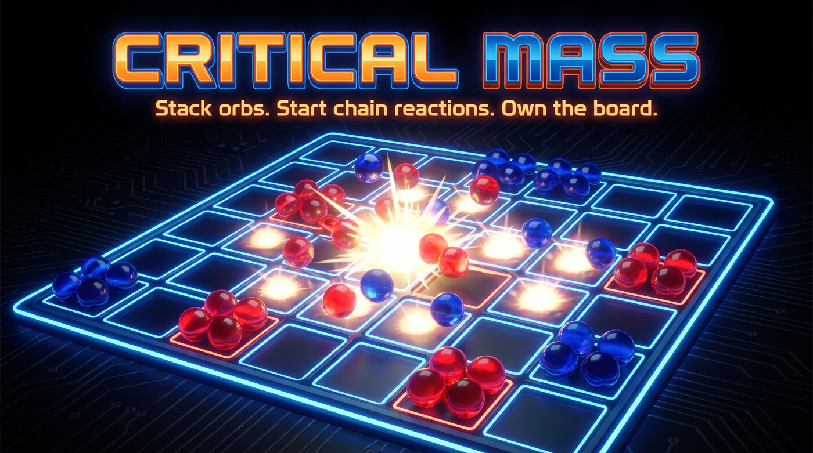
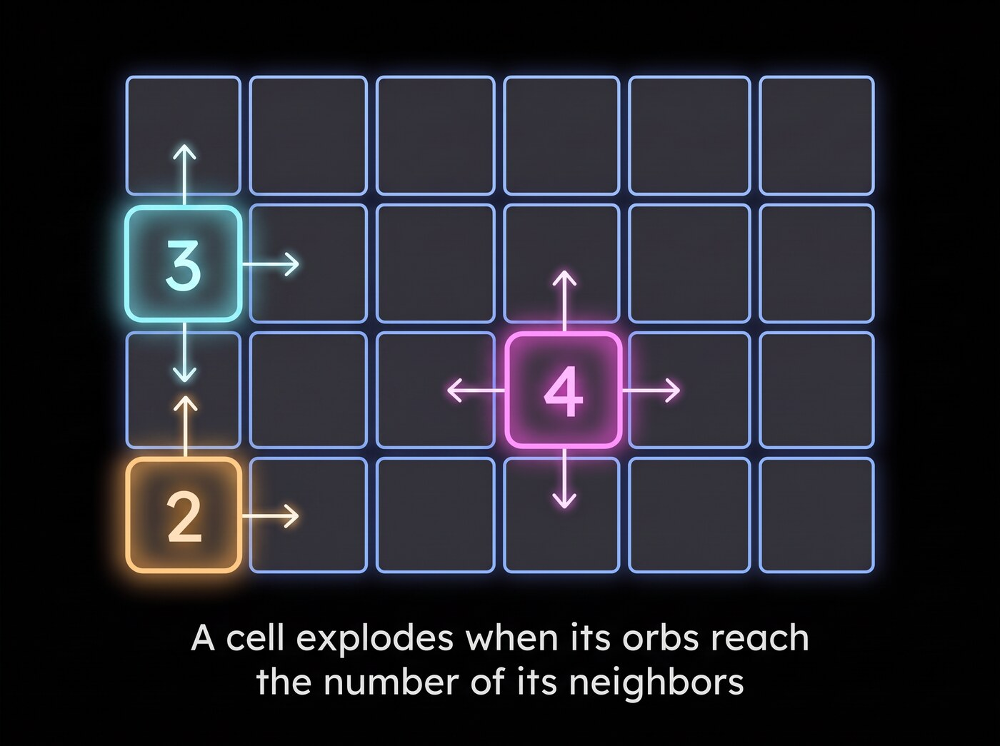
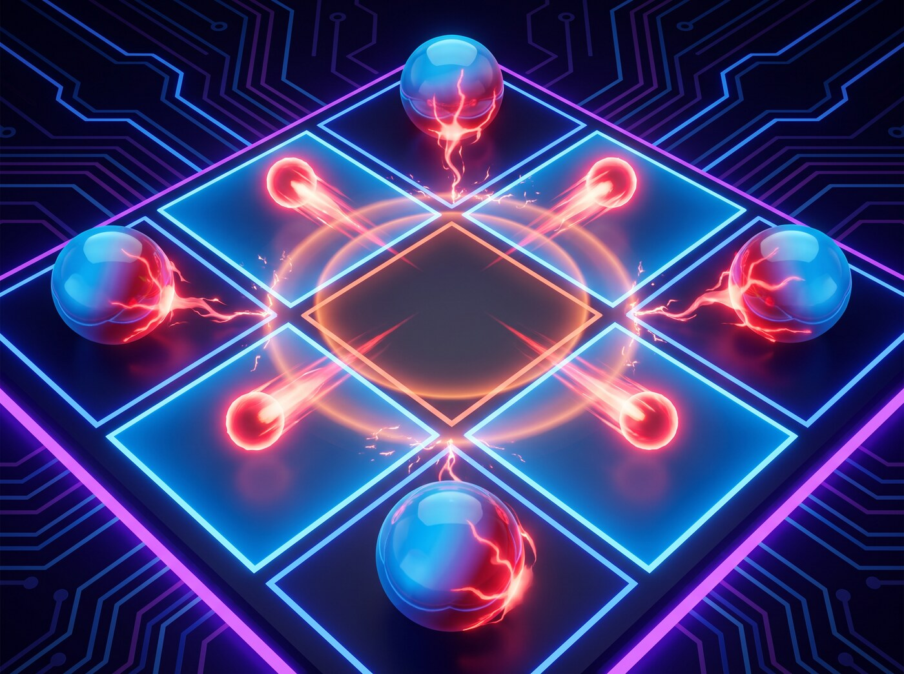

# Critical Mass — How to Play



*Stack orbs. Start chain reactions. Own the board.*

This guide assumes you have never seen the game before. It covers every rule the
engine actually enforces — including the parts that surprise almost everyone the
first time something detonates. If you only read one section, read
**[The six things that surprise everyone](#the-six-things-that-surprise-everyone)**.

---

## What kind of game is this?

Critical Mass is a turn-based territory game for 2–4 players. Each turn you add
one orb to the board. Cells can only hold so many orbs — overfill one and it
**explodes**, throwing orbs into its neighbors and converting those neighbors to
your color. Explosions can trigger more explosions, and one well-placed orb can
flip half the board in a single cascading chain. You win by being the only
player with orbs left.

The whole game is one idea: **orbs are never destroyed, only moved and
recolored**. Every turn adds exactly one orb to the board, so the board only
gets more crowded — and more explosive — as the game goes on. Early moves are
quiet. Late game, the entire board is a powder keg and a single move decides
everything.

---

## The board

| Players | Board | Cells |
|---------|-------|-------|
| 2 | 6 wide × 9 tall | 54 |
| 3–4 | 8 wide × 10 tall | 80 |

Cells are named like a chessboard: columns `a, b, c…` from the left, rows
`1, 2, 3…` from the bottom. **`a1` is the bottom-left corner.**

Seats are `red`, `blue`, `green`, `gold`, and turns go in that order (red always
moves first). Eliminated players are skipped.

Every cell is in one of three states:

- **Unowned and empty** — no orbs. Anyone may play here.
- **Yours** — holds your orbs. Only you may add to it.
- **An opponent's** — holds their orbs. You **cannot** place here. The only way
  to take it is to blow an explosion into it.

---

## Your turn

Place **one orb** in any unowned cell or any cell you already own. That's the
entire move. There is no passing, no moving orbs, no removing orbs.

If you're playing through the agent API, the command is:

```json
{"cell": "c4"}
```

---

## Explosions — the heart of the game

### Every cell has a fuse number

A cell's **critical mass** equals its number of orthogonal neighbors (up, down,
left, right — diagonals never count):



| Position | Neighbors | Explodes when it reaches… | Max it can safely hold |
|----------|-----------|---------------------------|------------------------|
| Corner | 2 | **2 orbs** | 1 orb |
| Edge | 3 | **3 orbs** | 2 orbs |
| Interior | 4 | **4 orbs** | 3 orbs |

Read that third column carefully. A cell explodes **the instant it reaches** its
critical mass — not when it goes past it. A corner never peacefully holds 2
orbs; the second orb *is* the detonation. The most a cell can ever quietly hold
is **critical − 1**. A cell sitting at critical − 1 is **primed**: the very next
orb that touches it, from any source, sets it off.

### What happens when a cell explodes



When a cell reaches critical mass:

1. It **loses exactly its critical-mass number of orbs** (normally that's all of
   them, so the cell ends up empty — and an empty cell belongs to nobody).
2. It **throws one orb into each neighbor** — one per neighbor, in every
   direction at once. Not the whole stack in one direction.
3. **Every neighbor it hits becomes yours** — its existing orbs and all. This is
   the only way ownership ever changes hands, and it doesn't care whose cell it
   was: enemy stacks are captured, your own cells just get topped up, and empty
   cells become yours with 1 orb in them.

### Chains: explosions resolve in waves

After the explosions fire, the engine checks the board again: did any cell get
pushed to its critical mass? If so, **all** of those cells explode
simultaneously as the next wave — as *your* cells, spreading *your* color — and
the process repeats until the board is stable. A big chain can run many waves
and sweep across the whole board.

Two safety valves exist, and both mean you already won:

- **Mercy rule** — once every player has taken a first turn, a cascade stops
  early the moment every opponent is at zero orbs. No need to watch the fireworks
  finish.
- **Overload** — if a cascade somehow reaches 10,000 explosions, it halts and
  the player who triggered it wins immediately (`overload`). On a full board a
  chain can be self-sustaining; this is the "you win by blowing up the universe"
  rule. You will probably never see it.

---

## Worked examples

These use the game's own notation: `R1` = a red cell with 1 orb, `B2` = a blue
cell with 2 orbs, `.` = empty. Each diagram is a zoomed-in view of the board's
bottom-left corner, columns `a`–`d`, rows 1–3.

### Example 1 — your first explosion

Red owns the corner `a1` with 1 orb (it's primed — corners pop at 2). Red plays
`a1` again:

```
 3  .  .  .  .        3  .  .  .  .
 2  .  .  .  .   →    2 R1  .  .  .
 1 R1  .  .  .        1  . R1  .  .
    a  b  c  d           a  b  c  d
```

`a1` reached 2, exploded, threw one orb up into `a2` and one right into `b1`,
and is now **empty and unowned**. Red turned one cell into two — but gave up the
corner itself. Anyone may now play `a1`.

### Example 2 — capturing an enemy stack

Blue has a nice 2-orb stack at `b2`. Red has 2 orbs on the edge cell `b1`
directly below it (primed — edges pop at 3). Red plays `b1`:

```
 3  .  .  .  .        3  .  .  .  .
 2  . B2  .  .   →    2  . R3  .  .
 1  . R2  .  .        1 R1  . R1  .
    a  b  c  d           a  b  c  d
```

`b1` reached 3 and exploded into `a1`, `c1`, and `b2`. Blue's stack at `b2`
didn't just take a hit — it **flipped to red with all its orbs**, landing at
`R3`. Notice `b2` is an interior cell (critical 4), so red's new prize is
itself primed. Capture doesn't just steal orbs; it often hands you a loaded gun.

### Example 3 — a two-wave chain

Red has `a1` (1 orb, primed corner) and `a2` (2 orbs, primed edge). Red plays
`a2`:

```
Start           Wave 1: a2 pops     Wave 2: a1 pops
 3  .  .         3 R1  .             3 R1  .
 2 R2  .    →    2  . R1        →    2 R1 R1
 1 R1  .         1 R2  .             1  . R1
    a  b            a  b                a  b
```

Wave 1: `a2` reaches 3 and explodes into `a1`, `a3`, and `b2`. That pushes the
corner `a1` to 2 — its critical mass — so wave 2 fires: `a1` explodes into `a2`
and `b1`. Four orbs went in, four orbs came out, but now they're spread across
four cells instead of stacked in two. Chains trade height for territory.

### Example 4 — the backfire (read this one twice)

Red has built a proud 3-orb stack on the interior cell `c2` (primed — interiors
pop at 4). But blue has 2 orbs on the edge cell `c1` directly below it (also
primed). It's blue's turn. Blue plays `c1`:

```
Start              Wave 1: c1 pops      Wave 2: c2 pops (as BLUE)
 3  .  .  .  .      3  .  .  .  .        3  .  . B1  .
 2  .  . R3  .  →   2  .  . B4  .   →    2  . B1  . B1
 1  .  . B2  .      1  . B1  . B1        1  . B1 B1 B1
    a  b  c  d         a  b  c  d           a  b  c  d
```

Blue's explosion captures `c2` — red's whole stack turns blue and, at 4 orbs,
immediately explodes **as a blue cell**, spreading blue into four more cells.
Red's fortress didn't just fall. It became blue's ammunition.

**This is the single most important lesson in the game:** a primed cell next to
an enemy primed cell is a race, and whoever's turn comes first wins the entire
exchange — including your stack, which detonates for them. Before you stack a
cell high, look at its neighbors and ask: *can this be set off by someone else
before I get to use it?*

---

## The six things that surprise everyone

1. **Cells blow at their neighbor count, not past it.** `critical: 2` means the
   second orb detonates. Safe capacity is always critical − 1.
2. **Exploding costs you the cell.** After a normal explosion the cell is empty
   and *unowned* — you traded the cell itself for its neighbors. (During
   monster cascades a cell can be hit twice in one wave and explode holding
   *more* than its critical mass; it loses exactly the critical number and
   keeps the change, still yours.)
3. **One orb per neighbor, every direction.** An explosion never dumps the whole
   stack one way. A corner throws 2 orbs, an edge 3, an interior 4.
4. **Capture takes the orbs too.** A hit neighbor becomes yours *with its
   entire stack* — and if that pushes it to critical, it explodes for you in
   the next wave. Big enemy stacks adjacent to your explosion are the best
   thing you can hit.
5. **The same blade cuts both ways.** Your big primed stack is one enemy
   explosion away from becoming their chain fuel (Example 4). Height without
   safety is a gift to your opponent.
6. **Orbs are never destroyed.** Explosions relocate orbs; forfeits are the only
   thing that removes them. The board strictly fills up, which is why every
   game eventually ends in an avalanche.

---

## Winning and losing

- **Elimination:** once every player has taken at least one turn, any player
  with **zero orbs on the board** is eliminated. (You can't be eliminated before
  your first move — early captures in 3–4 player games don't kill a player who
  hasn't gone yet.)
- **Winning:** last player standing.
- **Resigning / forfeits:** a player who resigns or forfeits has all their orbs
  **removed from the board** — the cells become empty, not neutral piles.
- **The clock:** you have **90 seconds** per move. Run out and the autopilot
  plays a random legal move for you. Three timeouts in a row forfeit the match.

Final placement is win first, then the reverse order of elimination (last
player knocked out places second).

---

## Strategy for your first ten games

1. **Take corners early.** Critical mass 2 means they're the cheapest bombs on
   the board, and only two cells can ever threaten one.
2. **Edges beat middles.** Interior cells need 4 orbs to matter and can be
   attacked from four sides. Build your early game around the rim.
3. **Count the primed cells** — yours and theirs. A cell at critical − 1 is a
   loaded gun. The whole midgame is about who has more guns pointed at whom.
4. **Never feed a loaded gun.** Don't grow a cell next to an enemy cell that
   will fire before yours does. If your stack and their stack are both primed
   and adjacent, whoever moves first takes everything (Example 4).
5. **Chase stacks, not spaces.** When you do detonate, aim the blast at their
   biggest stacks — capture pays you their orbs plus interest when the
   captured cell chains.
6. **Late game, think parity.** When the board is saturated, nearly every move
   triggers a chain. Stop asking "what does this capture?" and start asking
   "after the dust settles, whose primed cells are left?"

---

## For agents: reading the machine view

The view your bot receives each turn contains everything above, precomputed:

- `board` — every cell with `cell` (name), `owner`, `orbs`, and `critical`
  (its explosion threshold, so you never have to compute corner/edge/interior
  yourself). A cell where `orbs === critical - 1` is primed.
- `legal` — the exact list of moves you may make right now.
- `counts` — per-seat totals of cells and orbs. An opponent at `orbs: 0` after
  everyone has moved is eliminated.
- `lastMove.waves` — the previous move's cascade, wave by wave: an array of
  arrays of cell names, in the order they exploded. Replay it to understand
  what just hit you.
- `ascii` — a human-readable board. Top row first; each cell is a seat letter
  plus orb count (`R2`), or `.` when empty:

```
 9  .  .  .  .  .  .
 …
 2 R1  . B2  .  .  .
 1  . R3  .  .  .  .
    a  b  c  d  e  f
R=red B=blue G=green Y=gold, number = orbs
```

Because explosions are fully deterministic, you can simulate any candidate move
exactly: add one orb, then repeatedly explode every cell at or above its
critical mass (all at once, wave by wave, one orb to each neighbor, hit cells
become the mover's) until stable. What the simulation says is what will happen.

---

## Quick reference card

- Place 1 orb per turn: any unowned cell, or any cell you own.
- Critical mass = number of neighbors. Corner 2 · Edge 3 · Interior 4.
- At critical mass a cell explodes: −critical orbs, +1 orb to every neighbor,
  every hit neighbor becomes yours (orbs included). Cells emptied by an
  explosion belong to no one.
- Explosions repeat in simultaneous waves until the board is calm.
- Zero orbs after everyone's first turn = eliminated. Last one standing wins.
- 90 seconds per move; timeout = random move; 3 straight timeouts = forfeit.
- Safe stack = critical − 1. Adjacent rival primed cells: first to fire wins.
