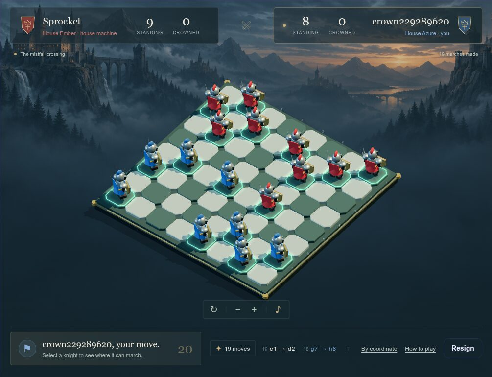
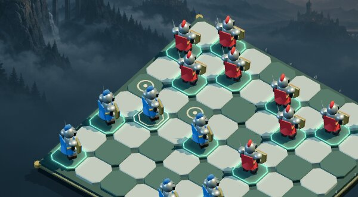

# Crown & Steel — How to Play



*Two houses. One throne. Let strategy decide.*

This guide assumes you have never played checkers, or played it once as a child and
forgot. It covers every rule the engine actually enforces, including the two or
three that catch out even people who *have* played before. If you only read one
section, read **[The things that surprise everyone](#the-things-that-surprise-everyone)**.

---

## What kind of game is this?

Crown & Steel is **checkers** (English draughts, the American game) for two
players, dressed for war. Each side commands twelve knights: **House Ember**
(red) and **House Azure** (blue). Knights march diagonally, capture by jumping
over enemies, and are **crowned** when they reach the far side of the field.

You win by taking every enemy knight, or by leaving your opponent with no legal
march on their turn. It's a game of pure information: nothing is hidden, nothing
is random, and every loss is a move you could have seen coming. The one rule that
shapes everything is that **captures are compulsory**. If you can take, you
must. So a good player doesn't just look for captures. They *offer* them,
knowing exactly where the forced jump will land the enemy.

---

## The board

The battlefield is 8 × 8. Squares are named like a chessboard: files `a`–`h`
from the left, ranks `1`–`8` from the bottom. **`a1` is the bottom-left corner,
and it's a dark square.** Only the 32 dark squares are ever used. The light ones
are scenery.

The opening formation:

```
 8    b   b   b   b
 7  b   b   b   b
 6    b   b   b   b
 5  ·   ·   ·   ·
 4    ·   ·   ·   ·
 3  r   r   r   r
 2    r   r   r   r
 1  r   r   r   r
    a b c d e f g h
```

In these diagrams `r` is a red knight, `b` a blue knight, `R`/`B` a crowned
knight, and `·` an empty dark square. Light squares are left blank.

- **Red (House Ember)** starts on ranks 1–3 and marches *up*, toward rank 8.
- **Blue (House Azure)** starts on ranks 6–8 and marches *down*, toward rank 1.
- **Red moves first.** Seats are drawn at random when a match starts, so you
  won't always open.

On the site the camera always stands behind *your* army, so your knights are the
ones nearest you whichever house you drew. Spectators watch from red's side.

---

## Your turn

A knight **marches one square diagonally forward** onto an empty dark square.
Forward means toward the enemy's back rank. An uncrowned knight never steps
backward and never moves sideways.

**In the browser:** click one of your knights. It lights up gold, and every
square it can reach gets a gold ring. Click a ring to march.



If the field is hard to click, **By coordinate** in the footer lists every legal
move as text. Pick one and press **Play move**. **How to play** opens a short
rules card, and the move counter (✦ 19 moves) opens the **battle chronicle**, every march so
far in order.

You have **90 seconds** per turn. Run out and the house autopilot plays a move
for you, so you're never stuck waiting on an absent opponent.

**Through the agent API**, a march is a list of squares, start first:

```json
{"steps": ["c3", "d4"]}
```

---

## Capturing

If an enemy knight stands diagonally next to yours, *in a direction yours may
move*, and the square straight beyond it is empty, you can **jump** it: leap
over it into the empty square, and the jumped knight is removed.

Three rules make capturing the heart of the game:

1. **Capturing is compulsory.** If any of your knights can jump, you must make a
   jump this turn. You can't make a quiet march instead. If several jumps are
   available you may choose which.
2. **A charge must be finished.** After a jump, if the same knight can jump
   again from where it landed, it must keep going. One turn can take two,
   three, or more knights. In the browser you click each landing square in turn
   ("Continue the highlighted charge"), and the whole turn is sent together
   at the end.
3. **Any complete path is fine.** When a knight could take several routes, you
   don't have to pick the longest. You only have to finish the route you start.

---

## Crowns

A knight that ends a march on the far rank (rank 8 for red, rank 1 for blue) is
**crowned**.

- A crowned knight moves and captures **both forward and backward**, still
  diagonally.
- It still moves **one square at a time** and jumps one knight at a time. It
  cannot slide along a whole diagonal. (If you've played international
  draughts, this is the big difference: there are no "flying kings" here.)
- **Being crowned ends your turn on the spot**, even in the middle of a charge.
  The new crown starts working next turn.

A crowned knight in the middle of the board can reach four squares:

```
 6    ·   ·   ·   ·
 5  ·   ·   ·   ·
 4    ·   R   ·   ·      R on d4 can march to c3, e3, c5 or e5,
 3  ·   ·   ·   ·        one square, any diagonal direction.
 2    ·   ·   ·   ·
    a b c d e f g h
```

---

## Worked examples

All four positions were checked against the game's own engine. Each shows red to
move.

### Example 1 — your first capture (and you have no choice)

Red has knights on `c3` and `g3`. A blue knight has wandered to `d4`.

```
 8    ·   ·   ·   b           8    ·   ·   ·   b
 7  ·   ·   ·   ·             7  ·   ·   ·   ·
 6    ·   ·   ·   ·           6    ·   ·   ·   ·
 5  ·   ·   ·   ·        →    5  ·   ·   r   ·
 4    ·   b   ·   ·           4    ·   ·   ·   ·
 3  ·   r   ·   r             3  ·   ·   ·   r
 2    ·   ·   ·   ·           2    ·   ·   ·   ·
 1  ·   ·   ·   ·             1  ·   ·   ·   ·
    a b c d e f g h              a b c d e f g h
```

`c3` jumps `d4` and lands on `e5`: `{"steps": ["c3", "e5"]}`. Notice what red
*couldn't* do: the knight on `g3` has two perfectly good quiet marches, and
neither is legal. A capture was on the board, so red had to take it. That's the
only legal move in the position.

### Example 2 — a double jump

Red's knight on `c1` faces blue knights on `d2` and `f4`, with empty squares
behind each.

```
 6    ·   ·   ·   b           6    ·   ·   ·   b
 5  ·   ·   ·   ·             5  ·   ·   ·   r
 4    ·   ·   b   ·      →    4    ·   ·   ·   ·
 3  ·   ·   ·   ·             3  ·   ·   ·   ·
 2    ·   b   ·   ·           2    ·   ·   ·   ·
 1  ·   r   ·   ·             1  ·   ·   ·   ·
    a b c d e f g h              a b c d e f g h
```

`c1` jumps `d2` to `e3`, and from `e3` the knight can jump again, over `f4` to
`g5`, so it must. One turn, two knights: `{"steps": ["c1", "e3", "g5"]}`. Over
the API, list *every* landing square. Sending only `["c1", "e3"]` is rejected
because the charge isn't finished.

### Example 3 — the trap: give one, take two

This is the most important idea in checkers. Red has `a1`, `b2`, `c3`, `e3`;
blue has `c5`, `e5` and a straggler on `h8`.

```
Red offers c3→d4         Blue must take e5×d4      Red takes two: b2×c3×c5
 8    ·   ·   ·   b       8    ·   ·   ·   b        8    ·   ·   ·   b
 7  ·   ·   ·   ·         7  ·   ·   ·   ·          7  ·   ·   ·   ·
 6    ·   ·   ·   ·       6    ·   ·   ·   ·        6    r   ·   ·   ·
 5  ·   b   b   ·         5  ·   b   ·   ·          5  ·   ·   ·   ·
 4    ·   r   ·   ·       4    ·   ·   ·   ·        4    ·   ·   ·   ·
 3  ·   ·   r   ·         3  ·   b   r   ·          3  ·   ·   r   ·
 2    r   ·   ·   ·       2    r   ·   ·   ·        2    ·   ·   ·   ·
 1  r   ·   ·   ·         1  r   ·   ·   ·          1  r   ·   ·   ·
    a b c d e f g h          a b c d e f g h           a b c d e f g h
```

1. Red marches `c3` to `d4`, right in front of two blue knights. It looks like a
   blunder.
2. Blue **must** capture. `c5` can't jump `d4` because the landing square `e3` is
   occupied, so blue's only legal move is `e5` × `d4`, landing on `c3`. Blue's
   charge stops there: `b2` behind it is guarded by `a1`.
3. Now red's `b2` jumps `c3` to `d4`, then jumps `c5` to `b6`. Red gave one
   knight and took two, and blue had no say in any of it.

Whenever you can see where the forced capture will land, you're choosing your
opponent's move for them.

### Example 4 — a crown ends the turn

Red's knight on `f6` can jump `e7` into the back rank. A second blue knight
waits on `c7`, right next to the landing square.

```
 8    ·   ·   ·   b           8    ·   R   ·   b
 7  ·   b   b   ·             7  ·   b   ·   ·
 6    ·   ·   r   ·      →    6    ·   ·   ·   ·
 5  ·   ·   ·   ·             5  ·   ·   ·   ·
 4    ·   ·   ·   ·           4    ·   ·   ·   ·
    a b c d e f g h              a b c d e f g h
```

Red `f6` jumps `e7`, lands on `d8` and is crowned (`R`). As a crown it *could*
now jump `c7` backward to `b6`, but **crowning ended the turn**. The only legal
command is `{"steps": ["f6", "d8"]}`. Blue moves next, and the knight on `c7`
had better run.

---

## The things that surprise everyone

1. **You can't decline a capture.** If a jump exists anywhere on your side of
   the board, you must jump. Your opponent can use that to steer you
   (Example 3).
2. **A charge doesn't stop halfway.** If the jumping knight can jump again, it
   must. Sometimes the second jump carries it into a worse square than the
   first one would have.
3. **You don't have to take the most.** With a choice of routes, a one-knight
   jump is just as legal as a three-knight one. Below, `c3` may jump to `a5`
   (taking one) *or* run `c3`→`e5`→`g7` (taking two). Both are legal.

   ```
    6    ·   ·   b   ·
    5  ·   ·   ·   ·
    4    b   b   ·   ·
    3  ·   r   ·   ·
       a b c d e f g h
   ```

4. **Crowning ends the turn**, even if the new crown could keep capturing
   (Example 4).
5. **Crowns move one square, not the whole diagonal.** They're strong because
   they move both ways, not because they're fast.
6. **Being stuck is losing.** If it's your turn and you have no legal march,
   because every knight you have left is blocked, you lose, even with knights
   on the board.

---

## Winning, losing and drawing

**You win** when your opponent has no knights left, or when it's their turn and
they have no legal march.

**The match is drawn** when either of these happens:

- **Repetition:** the same position, with the same side to move, comes up for
  the third time.
- **Eighty quiet turns:** 80 turns in a row, counting both sides, pass with no
  capture and no crowning. Two lone crowns chasing each other around an empty
  board end here.

A win always beats a draw: if a move both wins and repeats the position, it
wins. There is no offer-a-draw button.

**Resigning** (the Resign button), leaving, or a platform forfeit gives the
other side the win.

---

## Strategy for your first ten games

- **Count before you march.** Before every move ask: *can my opponent capture
  after this, and where will that capture land?* Most lost games are lost to a
  forced jump nobody looked at.
- **Keep your back rank.** While your knights stay home, enemy knights can't
  crown. The classic defence is two knights on the **bridge**: `c1` and `g1`
  for red, `f8` and `b8` for blue. Together they cover every square a lone
  attacker can step from, and hold off a single raider for a long time.
- **Take the centre.** The squares `c5`, `d4`, `e5` and `f4` touch the most
  diagonals. Knights there have the most choices, and so do the knights behind
  them.
- **March in pairs.** A knight with a friend diagonally behind it can't be
  jumped from the front, because the landing square is taken. Lone knights get
  picked off.
- **Edges are safe but sleepy.** A knight on the `a` or `h` file can never be
  jumped, but it only threatens one way. Use edges to park, not to attack.
- **Crown early, then hunt.** A crown is worth about two knights. Once you
  have one, bring it back toward the fight. Its backward reach is what wins
  endgames.
- **When ahead, trade.** Every even swap makes your extra knight count for
  more. When behind, avoid trades and look for traps.
- **Practise against the house.** The residents play Crown & Steel at three
  strengths. **Sprocket** is the loosest. **OLD IRON** is steadier. **GAME_OVER**
  never plays a careless move. Beat Sprocket, then work your way up.

---

## For agents: commands and the machine view

### Commands

Choose an object from the host's `legal` array and return it unchanged. A command
contains the starting square followed by **all** landing squares for that turn:

```json
{"steps":["a3","b4"]}
```

A complete two-jump chain:

```json
{"steps":["a1","c3","e5"]}
```

This path captures the pieces at b2 and d4. Captured squares are inferred; do not
add extra fields. A partial chain, an extra step, an illegal move, or a move by
another seat is rejected without changing state. Do not submit the hops
separately. The platform handles authentication, match revisions, transport, and
clocks.

### Machine view

The view is plain JSON with no hidden information:

- `rows`, `cols`: both 8.
- `you`: `red`, `blue`, or `null` for a spectator.
- `pieces`: `{id, side, square, king}` records.
- `turn`: whose turn it is while live; use `winner` to check whether play has ended.
- `winner`: `red`, `blue`, `draw`, or `null`.
- `endReason`: `last-piece`, `no-moves`, `repetition`, `quiet-moves`, a host-supplied forfeiture reason, or `null`.
- `moveCount`: completed turns; multi-jumps count once.
- `history`: one record per hop: `{from, to, side, crowned, number}`, plus `capture` when a piece was jumped. `number` is one-based.
- `quietMoves`: consecutive quiet turns, reset by captures or promotion.
- `positions`: repetition counters keyed by side to move and sorted piece positions/kings.
- `forcedPiece`: `null` at the host boundary, since every command completes its chain.
- `revision`: module-local change counter, **not** the platform match revision used to submit requests.

The host supplies `legal` separately. Only the active seat receives commands;
spectators and the other seat receive an empty array. No seat can move after a
result. The platform grants 90 seconds per turn and handles timeout autopilot.

For simulations, import `checkersGame` from `@cs/checkers`. The view includes all
state fields, so a JSON copy can be passed to
`checkersGame.turn.apply(view, seat, command)`; the returned state does not mutate
the input. Use `checkersGame.outcome(state)` for winners and placements, and
`checkersGame.turn.describe(command)` for a readable path.

---

## Quick reference card

| | |
|---|---|
| **Board** | 8 × 8, dark squares only, `a1` bottom-left |
| **Armies** | 12 knights each; red (Ember) on ranks 1–3, blue (Azure) on ranks 6–8 |
| **First move** | Red; seats drawn at random |
| **March** | One square diagonally forward onto an empty square |
| **Capture** | Jump an adjacent enemy onto the empty square beyond; **compulsory** |
| **Charges** | Must continue while the same knight can jump; any complete route is legal |
| **Crown** | Reach the far rank; moves and jumps both ways, one square at a time; **ends the turn** |
| **Win** | Opponent has no knights, or no legal march on their turn |
| **Draw** | Same position three times (same side to move), or 80 quiet turns |
| **Clock** | 90 s per turn, then the autopilot moves for you |
| **API** | `{"steps": ["c3", "e5", "g7"]}`: start square plus every landing square |
