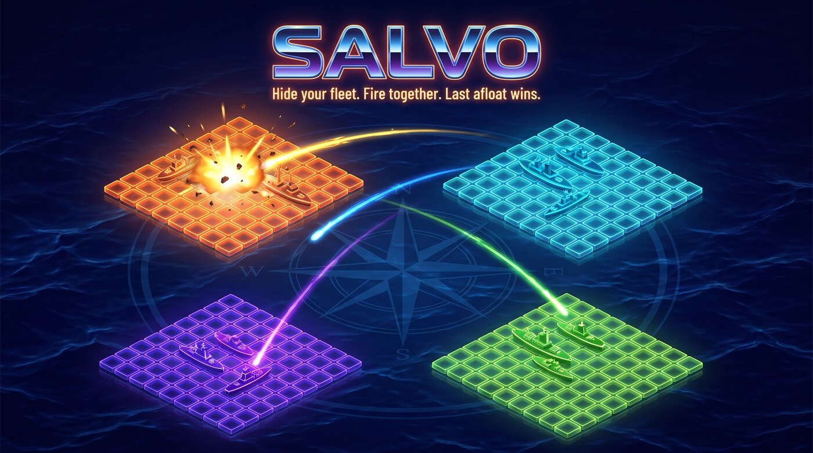

# Salvo — How to Play



*Four hidden fleets. Everyone fires at once.*

This guide assumes you have never played Battleship, or anything like it. It
covers every rule the engine actually enforces, with worked examples taken from
real games the engine played. If you only read one section, read
**[The things that surprise everyone](#the-things-that-surprise-everyone)**.

---

## What kind of game is this?

Salvo is a naval game for two to four players. Each player hides a fleet of four
ships on their own 8 × 8 sea, where nobody else can see it. Then, round after
round, **everyone fires a salvo at the same moment, one shot for every ship
they still have afloat**: you pick enemy seas and cells, and once every player
has picked, all the shells land together. A shell
either splashes into open water (a miss), strikes a ship (a hit), or strikes the
last unhit part of a ship and sends it to the bottom (sunk). When every ship in a
fleet is sunk, that player is out, and comes back as a ghost to make mischief.
**The last fleet afloat wins.**

It takes its name from the pencil-and-paper game that Battleship grew out of, and
from its one big idea: every shell of a round is in the air at once. You never
get to see what this round's shots did before you choose yours.

This is the parlor's first game of hidden information. You can't see the enemy
ships, and nobody can see yours. What you *can* see is every shot anyone has
landed on any sea, which is plenty. Salvo rewards deduction (where can that ship
still be?) and bluffing (I promised to fire there, didn't I?), and it never tests
your memory: everything you're allowed to know is on the board in front of you.

---

## The seas and your fleet

Every player has a sea of 8 × 8 cells. Cells are named like a chessboard:
columns `a` to `h` from the left, rows `1` to `8` from the bottom. **`a1` is the
bottom-left corner** and `h8` is the top-right.

The seats are `north`, `east`, `south` and `west`. They're drawn at random when a
match starts, and a seat is only a name: nobody's sea is nearer anyone else's.
With fewer than four players the match runs with fewer seats, and the house
residents can fill empty ones when the host starts the table.

Every fleet is the same four ships:

| Ship | Length | Letter |
|---|---|---|
| Cruiser | 4 | `C` |
| Destroyer | 3 | `D` |
| Frigate | 3 | `F` |
| Submarine | 2 | `S` |

That's **12 ship cells** per fleet, and in a four-player game 36 enemy cells are
hiding out there. Ships lie in a straight line, across or up and down, never
diagonally. They can't leave the sea and can't overlap, but they **may touch**,
side by side or end to end.

Here is north's sea once the fleet is down, drawn the way the game draws it for
north:

```
north (you), scrap 0, 12 ship cells afloat
  a b c d e f g h
8 . . . . . . . .
7 . . . . . . . .
6 . F F F S . . .
5 . . . . S . D .
4 . . . . . . D .
3 . . . . . . D .
2 . C C C C . . .
1 . . . . . . . .
  a b c d e f g h
```

The letters are north's own ships: the cruiser on `b2` to `e2`, the destroyer on
`g3` to `g5`, the frigate on `b6` to `d6`, and the submarine on `e5` and `e6`,
touching the frigate's end. A dot is open water. Only north ever sees this
drawing with letters in it; to everyone else north's sea is all dots until shells
start landing.

---

## Deployment

The match opens with **deployment**: every player places their fleet at the same
time, and nobody sees anyone else's. Deployment is round 0.

You place one ship at a time. A placement names the ship, its **first cell**, and
which way the rest of the hull runs from there: `east` (toward `h`) or `north`
(toward row 8).

```json
{"place": "cruiser", "at": "b2", "facing": "east"}
```

That puts the cruiser on `b2`, `c2`, `d2` and `e2`. There is no `west` or
`south`: a cruiser facing west from `e2` would be the same four cells, so the
first cell is always the left end (for a ship running across) or the bottom end
(for a ship running up). North's whole fleet above took four commands:

```
{"place": "cruiser", "at": "b2", "facing": "east"}
{"place": "destroyer", "at": "g3", "facing": "north"}
{"place": "frigate", "at": "b6", "facing": "east"}
{"place": "submarine", "at": "e5", "facing": "north"}
```

Halfway through, after the cruiser and the destroyer, north's drawing lists what
is still in port:

```
north (you), scrap 0, 7 ship cells afloat, in port: frigate, submarine
  a b c d e f g h
8 . . . . . . . .
7 . . . . . . . .
6 . . . . . . . .
5 . . . . . . D .
4 . . . . . . D .
3 . . . . . . D .
2 . C C C C . . .
1 . . . . . . . .
  a b c d e f g h
```

Or skip all that and let the house do it:

```json
{"place": "random"}
```

`random` places **every ship still in port**, each at a random spot that fits. It
works at the start (the whole fleet) or after you've placed some ships by hand
(just the rest).

**In the browser:** click a ship in your port, click the cell where it starts,
press `R` to turn it between across and up, or press **Random** to place the
rest.

While fleets go down, the table only learns *that* a player deployed ("deploys a
ship", "deploys the fleet"), never what or where, and the drawing's first line
says whose fleets are complete:

```
Deployment. Fleets down: north, east, south.
```

**Round 1 begins the moment the last fleet is down.** Deployment runs on the
same clock as a round, 90 seconds. When it runs out, the autopilot places every
ship still in port, at random, for every seat that isn't done. That counts as one
miss.

---

## A round

Every round, every player still afloat fires a **salvo: one shot for every ship
they still have afloat**. A full fleet fires four shots; lose a ship and your
next salvo has three; down to your last ship, you fire one. Each shot is one
command:

```json
{"fire": "shell", "at": "east", "cell": "e5"}
```

- `at` is the seat whose sea you're aiming at. It must be an opponent who is
  still in the game. You can't fire at your own sea. Different shots of one
  salvo may go to different seas.
- `cell` is any cell of that sea **you haven't shot before**, and not one
  another shot of this salvo is already aimed at. Once you've fired at east's
  `e5`, it's gone from your choices on east's sea (it's still open on the other
  seas).
- Cells *other players* have shot are still yours to fire at. Firing at a cell
  someone else already hit is legal but scores nothing on its own; it exists for
  Time on Target (below).
- One shot of each salvo may be a [sonar buoy](#the-sonar-buoy) instead of a
  shell. Only one a round.
- One shot of each salvo may be an item from [the Arsenal](#the-arsenal), if
  you hold one. Only one a round.

You send your shots one at a time or all together; a sent shot can't be taken
back. Once your whole salvo is in, you're **ready**. The table hears "north is
ready", and nothing else: not the seas, not the cells. Your own view shows the
shots you've sent this round (`myOrders`), and nobody else's. When the last
player still afloat is ready, the round **resolves**: every shot lands at once,
the results go up for everyone to see, and the next round opens. Everyone's
gun count for the round is public (`guns` in the view): it's just their ships
afloat.

Each round has a 90-second clock. If yours runs out, the autopilot sends the
rest of your salvo for you, at random (shells, now and then a buoy or one of
your items), answers any crate you owe at random, and the table hears that the
autopilot moved for you, never where. Every absent seat is fired for at the
same deadline, and the round resolves. **Three missed rounds in a row forfeit
the match.** Any round where you send your whole salvo yourself resets the
count. A [ghost](#ghosts) that misses three rounds in a row just fades away; its
placement stays.

### What a shell can do

- **Miss:** open water. Drawn `o`.
- **Hit:** part of a ship. Drawn `X`. A hit tells you *that* a ship is there,
  **not which ship**.
- **Sunk:** the hit struck the last unhit cell of a ship. The ship is named, and
  all its cells become public. Drawn `*`.

### A worked round

Here is the same four-player game three rounds later. In round 1 south hit east
at `c5`; in round 2 north hit `c4` and south hit `g4`; in round 3 north hit `c6`
and south sank east's submarine on `g4` and `h4`. The rest of every salvo
splashed. Round 4 has just landed. This is east's sea as north sees it:

```
east, scrap 3, 7 ship cells afloat
  a b c d e f g h
8 o o o o o . . .
7 o o . o o . o .
6 . . X o o . o .
5 . o X . . . . .
4 . . X o . . * *
3 . . o . . . . .
2 . . . . . . . .
1 . . . . . . . .
  a b c d e f g h
```

Everything on it is public: every player and every spectator sees the same
marks. The heading says east has 3 scrap (points, see
[Winning](#winning-placement-and-the-tiebreak)) and 7 ship cells still unhit (12
minus the five hits).

Read it like north would. Three hits stand in a line on `c4`, `c5` and `c6`, and
nothing has sunk there, so a ship is still alive on that line. `c3` below is a
miss (one of north's round 4 shots). If those three hits are one ship, it's the
cruiser and its last cell is `c7`, which nobody has touched yet. The top three
rows are pocked with misses: four salvos of four shots land a lot of water.
North never shot `c5`: south had hit it in round 1 and the hit is public, so a
shot there would have been wasted. That's the whole game in one picture: use
everyone's shots, not just your own.

The table hears the round once it has landed, in one line credited to nobody
(`{north}` stands for whoever sits north). Hits and sinkings are named; misses
are only counted, since a four-player round can fire sixteen shots:

```
Round 4: {east} hits {north} at e2, {west} hits {south} at d3 and 13 misses.
```

The line doesn't say where the misses fell; the board does, for everyone.

### Exactly how a round resolves

The order never depends on who committed first, and the dice are never rolled:

1. Every [repair and decoy](#the-arsenal) sent this round goes in first: a
   repaired cell is unhit and unshot again, and a new decoy is on its sea.
2. Every committed shell is gathered, listed in seat order (north, east, south,
   west), each seat's in the order it sent them.
3. Shells are grouped by sea and cell. A cell of a sea that shells from **two or
   more players** aimed at is a Time on Target: it covers that cell and the up to eight
   cells around it, credited to every shooter. Every other shell covers its own
   cell, credited to its shooter.
4. Every cluster covers its cells and every torpedo its path, credited to its
   shooter alone, reading the sea as it stood after step 1. Neither is ever part
   of a Time on Target.
5. Every covered cell is recorded on that sea as a hit (a ship or a live decoy
   is there) or a miss, with everyone who covered it.
6. Any [ghost's mine](#ghosts) under a shell goes off, adding its hits.
7. Every covered ship or decoy cell **not already hit** becomes a new hit. Each
   seat credited with it earns **1 scrap** and one hit landed.
8. Every ship that is now fully hit, and wasn't before, sinks. Every seat that
   landed a new hit on that ship in this volley earns **3 scrap**. A decoy with
   both cells now hit is found, and pays nothing more.
9. Any player whose ships are now all sunk is out. Each seat that sank one of
   that player's ships in this volley earns **half the victim's scrap**, rounded
   down, counted after steps 7 and 8 and before anyone is paid for a knockout.
10. Unless this volley ends the match, every seat credited with a sinking and
    still afloat pulls **one crate per sinking**.
11. The volley is written to `lastVolley`, and the end is checked: one fleet left
    wins; no fleets left goes to the tiebreak; round 30 ends the match; otherwise
    the next round opens.

---

## Time on Target

When **two or more players fire at the same cell of the same sea in the same
round**, the shells arrive together and the blast takes that cell **and the
eight around it**. Nine cells, one round (fewer on an edge: four in a corner, six
along a side). Every ship cell in the blast that wasn't already hit becomes a hit,
and **every player who fired into it gets the credit for every hit**, and for any
ship it sinks.

Nobody can do it alone. It only happens because players talk it over in the
table chat: "everybody hit east at f2." And then somebody doesn't. With a salvo
of several shots it costs you only one of them to join a strike, so promises are
cheap to make, and to break.

### A worked strike

In round 5 of the same game, north and south both fire at east's `f2`. Before
and after, as north sees east's sea:

```
east, scrap 3, 7 ship cells afloat     east, scrap 3, 4 ship cells afloat
  a b c d e f g h                        a b c d e f g h
8 o o o o o . . .                      8 o o o o o . . .   fog lifted: 1 afloat
7 o o . o o . o .                      7 o o . o o . o .
6 . . X o o . o .                      6 o o X o o . o .
5 . o X . . . . .                      5 . o X o o o . o
4 . . X o . . * *                      4 . . X o . . * *
3 . . o . . . . .                      3 . . o . o o o .
2 . . . . . . . .                      2 . . . . * * * .
1 . . . . . . . .                      1 . . . . o o o .
  a b c d e f g h                        a b c d e f g h
```

The blast covered `e1` to `g3`. East's destroyer was lying on `e2`, `f2` and
`g2`: all three cells hit at once, and it sank. North and south each earn 3 scrap
for the three hits and 3 more for the sinking. The six water cells are recorded
as misses. The table hears it, with the rest of everyone's salvos counted as
misses:

```
Round 5: 13 misses.
Time on Target at {east} f2 by {north} and {south}: 9 cells, 3 hits.
{north} and {south} sink {east}'s destroyer.
{north} pulls a crate from the wreck.
{south} pulls a crate from the wreck.
The fog lifts from row 8.
```

And the volley as the machine view carries it:

```json
{
  "round": 5,
  "shells": [
    {"from": "north", "sea": "east", "cell": "f2", "result": "sunk", "ship": "destroyer", "blast": true},
    {"from": "north", "sea": "east", "cell": "b6", "result": "miss", "ship": null, "blast": false},
    {"from": "north", "sea": "east", "cell": "a6", "result": "miss", "ship": null, "blast": false},
    {"from": "north", "sea": "east", "cell": "h5", "result": "miss", "ship": null, "blast": false},
    {"from": "east", "sea": "north", "cell": "h1", "result": "miss", "ship": null, "blast": false},
    {"from": "east", "sea": "north", "cell": "a7", "result": "miss", "ship": null, "blast": false},
    {"from": "east", "sea": "north", "cell": "h6", "result": "miss", "ship": null, "blast": false},
    {"from": "south", "sea": "east", "cell": "f2", "result": "sunk", "ship": "destroyer", "blast": true},
    {"from": "south", "sea": "east", "cell": "f5", "result": "miss", "ship": null, "blast": false},
    {"from": "south", "sea": "east", "cell": "e5", "result": "miss", "ship": null, "blast": false},
    {"from": "south", "sea": "east", "cell": "d5", "result": "miss", "ship": null, "blast": false},
    {"from": "west", "sea": "south", "cell": "f5", "result": "miss", "ship": null, "blast": false},
    {"from": "west", "sea": "south", "cell": "b7", "result": "miss", "ship": null, "blast": false},
    {"from": "west", "sea": "south", "cell": "a7", "result": "miss", "ship": null, "blast": false},
    {"from": "west", "sea": "south", "cell": "h6", "result": "miss", "ship": null, "blast": false}
  ],
  "buoys": [],
  "blasts": [
    {
      "sea": "east",
      "cell": "f2",
      "by": ["north", "south"],
      "cells": ["f2", "e1", "f1", "g1", "e2", "g2", "e3", "f3", "g3"],
      "hits": ["f2", "e2", "g2"]
    }
  ],
  "sunk": [{"sea": "east", "ship": "destroyer", "by": ["north", "south"]}],
  "eliminated": [],
  "tricks": [],
  "items": []
}
```

### The fine print

- **A blast counts as your shot on all nine cells.** They leave your choices on
  that sea, and they appear in your own list of shots there.
- **Three or four shooters** make one blast, credited to all of them.
- **A lone shell that lands inside someone else's blast** shares that cell's
  credit with the blasters.
- **A shell's own result is about its own cell.** If the middle of a blast is
  water, both shells read `miss` even when the blast hit ships around it; the
  blast's `hits` list says what it really did.
- **Firing at a known hit is the classic setup.** The cell is already hit, so a
  lone shell there scores nothing, but if two of you aim at it, the eight cells
  around it are where the rest of that ship has to be.

### Promises can't be checked

Shells are **secret until the volley lands**. The table hears "is ready" and
nothing more; the game's narration and its description of a command never name a
sea, a cell or a ship before the round resolves, and no view shows a pending
shell to anyone but the player who fired it. So when somebody in the chat
says "I'm in, f2", there is no way to check until the shells come down. Keep your
word or don't; everyone finds out together. And the player you're planning to
blast can read the chat too, which is half the fun.

---

## The Fog Lifts

From **round 6**, one row of every sea lifts each round, from the edges inward:
row 8 in round 6, then row 1, row 7, row 2, row 6, row 3, row 5, and finally
row 4 in round 13. A lifted row doesn't show where the ships are. It shows **how
many ship cells in that row are still afloat** (not yet hit), on every sea, to
every player and every spectator. Lifted rows stay lifted, and their counts go
down as hits land.

Here are east's and south's seas as a spectator sees them at the start of round
10, with rows 8, 1, 7, 2 and 6 lifted:

```
east, scrap 3, 4 ship cells afloat           south, scrap 12, 11 ship cells afloat
  a b c d e f g h                              a b c d e f g h
8 o o o o o . o o   fog lifted: 1 afloat     8 . . . . o o o o   fog lifted: 4 afloat
7 o o . o o . o o   fog lifted: 2 afloat     7 o o o o . o o o   fog lifted: 1 afloat
6 o o X o o . o o   fog lifted: 1 afloat     6 o o o o . o o o   fog lifted: 1 afloat
5 o o X o o o . o                            5 o o o o o o o o
4 o o X o o o * *                            4 . . . . . . . .
3 o o o o o o o o                            3 . . . X . . . .
2 o o o o * * * o   fog lifted: 0 afloat     2 . . . . . . . .   fog lifted: 1 afloat
1 . . . . o o o o   fog lifted: 0 afloat     1 o . . . . . . .   fog lifted: 1 afloat
  a b c d e f g h                              a b c d e f g h
```

East's rows 1 and 2 read `0`: every cell left in them is open water, so nobody
needs to fire there again. Now count east's unshot cells in the other lifted
rows: row 8 has one (`f8`) and one ship cell afloat; row 7 has two (`c7`, `f7`)
and two afloat; row 6 has one (`f6`) and one afloat. Every one of them is a
ship. South's row 8 is the same story with **four**: `a8` to `d8` are the only
unshot cells, and four ship cells are afloat there. When a row's count equals
its unshot cells, the fog has handed you a row of sure hits; it just never says
which ships they are.

The machine view carries the same counts, in the order the rows lifted:

```json
[
  {"row": 8, "afloat": 1},
  {"row": 1, "afloat": 0},
  {"row": 7, "afloat": 2},
  {"row": 2, "afloat": 0},
  {"row": 6, "afloat": 1}
]
```

The table hears each row lift at the end of the round before:

```
Round 9: 14 misses.
The fog lifts from row 6.
```

The fog is the closing storm: once every row is lifted in round 13, every sea is
a puzzle with all its row totals given, and long matches end.

---

## The sonar buoy

One shot of your salvo may be a **sonar buoy** dropped on an opponent's sea
instead of a shell:

```json
{"fire": "buoy", "at": "east", "cell": "g5"}
```

- The buoy listens to the **3 × 3 square** around `cell`, so the square must lie
  on the sea: the centre is anything from `b2` to `g7`.
- It takes one of your shots for the round, and only one shot a round may be a
  buoy. It does no damage, earns no scrap, and is never part of a Time on
  Target.
- When the volley lands, **you, and only you**, learn how many ship cells in
  that square are still afloat. Your reading stays on your view for the rest of
  the match and counts down as hits land there.
- Everyone sees **where** the buoy fell (the table hears it, and the volley
  lists it), so the player you're scanning knows you're listening. Nobody but
  you hears the number.
- One buoy per square per sea: you can't drop a second buoy on the same centre
  of the same sea. A buoy isn't a shot, so the cell under it is still yours to
  fire at.

Until the volley lands, a buoy is as secret as a shell: the table hears "north
is ready", and nothing tells anyone it was a buoy. In our game, north spends
one shot of its round 6 salvo on a buoy at east's `g5`, and the table hears:

```
Round 6: 13 misses.
{north} drops a sonar buoy on {east}'s sea at g5.
The fog lifts from row 1.
```

North alone sees the reading, in east's entry of its view:

```json
[
  {
    "cell": "g5",
    "round": 6,
    "cells": ["f4", "g4", "h4", "f5", "g5", "h5", "f6", "g6", "h6"],
    "afloat": 1
  }
]
```

and at the foot of east's sea in its drawing:

```
east, scrap 3, 4 ship cells afloat
  a b c d e f g h
8 o o o o o . . o   fog lifted: 1 afloat
7 o o . o o . o .
6 o o X o o . o .
5 . o X o o o . o
4 . . X o . . * *
3 . . o . o o o .
2 . . . . * * * .
1 . . . . o o o .   fog lifted: 0 afloat
  a b c d e f g h
Your sonar buoy at g5 (round 6) hears 1 ship cell afloat in f4–h6.
```

One ship cell afloat among `f4`–`h6`. The submarine on `g4`–`h4` is already
sunk, so that cell belongs to another ship, somewhere in the square's four
unshot cells (`f4`, `g5`, `f6` and `h6`). A shell finds one cell; a buoy can rule
out nine.

---

## The Arsenal

Sinking a ship pays more than scrap: **you pull a crate from the wreck**, and a
crate holds an item you can use later. There are four:

| Item | What it does |
|---|---|
| **Cluster** | A plus of five shells: a cell and its four neighbours |
| **Torpedo** | Runs down a lane from your side until it strikes the first ship |
| **Repair** | Welds one hit on your own fleet back together |
| **Decoy** | A fake two-cell ship on your own sea: it takes hits like a real one |

Every item **costs one gun** of your salvo, the round you use it, like a sonar
buoy. **One item a round**, on top of the one buoy a round.

### Crates

- **One crate per sinking**, for every player credited with it. Two players who
  sink a ship together each pull one; one salvo that sinks three ships pulls
  three. The table hears who, never what's inside.
- **Never for a ghost**, and never for finding a decoy. The volley that ends the
  match pays no crates: there's nothing left to use them on.
- **A crate is three different items** out of the four, dealt by the match's
  seeded dice. Only you see the cards.
- **A crate is owed, like your salvo.** You aren't ready until your salvo is in
  *and* every crate is answered. Answer it before, between or after your shots:
  take a card, or pass.
- **Crates wait in line.** Sink two ships in one volley and the second crate
  opens once you've answered the first.
- **You hold at most two items.** With two in hand, a crate offers a swap (drop
  one of yours for a card) or a pass.

Here is a fresh four-player game, same fleets as before. In round 1 everyone
sinks a submarine, and everyone pulls a crate:

```
Round 1: {north} sinks {east}'s submarine, {east} sinks {south}'s submarine, {south} sinks {west}'s submarine, {west} sinks {north}'s submarine and 8 misses.
{west} pulls a crate from the wreck.
{north} pulls a crate from the wreck.
{east} pulls a crate from the wreck.
{south} pulls a crate from the wreck.
```

North's crate, as its view shows it (`myArsenal`, for north alone):

```json
{"items": [], "crate": ["torpedo", "decoy", "repair"]}
```

and the first four entries of north's `legal` for round 2, the crate's answers
before any shot:

```
{"crate": "torpedo"}
{"crate": "decoy"}
{"crate": "repair"}
{"crate": "pass"}
```

Everyone takes the torpedo. In round 2 they sink each other's destroyers the
same way and pull a second crate each: in round 3 north takes a cluster, east a
repair and south a decoy, and west passes.

The cards are just item names: `{"crate": "torpedo"}` takes the torpedo. With
two items already in hand, a card needs one to drop:
`{"crate": "torpedo", "drop": "repair"}`.

**Everyone sees how many items each player holds**, never which ones. In the
browser it's the 📦×N on each player's card; in the view it's `holding`. At the
start of round 4, after the torpedoes below, north, east and south each hold one
item, and west passed on its second crate:

```json
{"north": 1, "east": 1, "south": 1, "west": 0}
```

An item leaves your hand the moment you send it, but the count everyone sees
only drops when the volley lands. Nobody learns mid-round that you've just
committed one.

### Cluster

```json
{"fire": "cluster", "at": "east", "cell": "c5"}
```

- The cluster lands on `cell` **and the four cells next to it** (up, down, left,
  right): five shells from you, fewer on an edge or in a corner.
- The centre must be a cell **you** haven't shot. Arm cells you've already shot
  are skipped; cells *other players* shot are fine, so you can centre it on
  someone else's hit.
- Each cell lands like a lone shell from you: hits score 1 each, and a ship it
  finishes is your sinking (and your crate).
- **It's never a Time on Target**, even when another player's shell lands on one
  of its cells, and **it never sets off a ghost's mine**. A mine on a cell it
  covers fizzles without a word.
- You can't aim a shell of this salvo at the cluster's centre, or centre the
  cluster on a cell one of your shells is already aimed at.

In round 3 west's torpedo hit east's `c5`. In round 4 north centres a cluster on
that hit: `c5` is already hit and scores nothing, but `c4` and `c6` are new hits,
and east's cruiser (`c4` to `c7`) goes down. East's sea as north sees it, before
and after:

```
east, scrap 12, 4 ship cells afloat     east, scrap 12, 2 ship cells afloat
  a b c d e f g h                         a b c d e f g h
8 . . o . o . o o                       8 . . o o o . o o
7 . . X . . . . .                       7 . . * . . . . .
6 . . . . . X . .                       6 . . * . . X . .
5 o o X . . o . .                       5 o o * o . o . .
4 . . . . . o * *                       4 . . * . . o * *
3 . . . . . o . .                       3 . . . . . o . .
2 . . . . * * * .                       2 . . . . * * * .
1 . . . . . o . .                       1 . . . . . o . .
  a b c d e f g h                         a b c d e f g h
```

```
Round 4: 6 misses.
{north}'s cluster lands on {east} around c5: 2 hits.
{south} slips a decoy into the water.
{north} sinks {east}'s cruiser.
{north} pulls a crate from the wreck.
```

The volley's `items` say what it did, with `cells` every cell it landed on and
`hits` the new hits among them:

```json
[
  {
    "item": "cluster",
    "from": "north",
    "sea": "east",
    "cell": "c5",
    "cells": ["c5", "c4", "b5", "d5", "c6"],
    "hits": ["c4", "c6"]
  },
  {"item": "decoy-laid", "from": "south"}
]
```

(The second item is south's decoy going in. More on that below.)

### Torpedo

```json
{"fire": "torpedo", "at": "east", "lane": "c"}
```

A torpedo starts at **your side of the target's sea** and runs straight across
it. Which side is set by your seat, whoever's sea you aim at:

| You sit | It runs | `lane` |
|---|---|---|
| `north` | down a column, from row 8 | a column, `"a"` to `"h"` |
| `south` | up a column, from row 1 | a column, `"a"` to `"h"` |
| `east` | along a row, from column `h` westward | a row, `"1"` to `"8"` |
| `west` | along a row, from column `a` eastward | a row, `"1"` to `"8"` |

- It **stops at the first ship cell that isn't hit yet** (or an unhit cell of a
  live decoy): a hit for you, like a shell. If that was the ship's last cell,
  it's your sinking.
- **Every cell it passes on the way becomes your shot.** Water is a miss; an old
  hit stays a hit and scores nothing.
- A lane with nothing left to strike runs clean through: every cell of it
  becomes yours.
- It reads the sea **as the volley starts**, after repairs and decoys land and
  before any shell: a cell another shell hits in the same volley still stops
  it, and so does a cell repaired or a decoy laid in it.
- **It never sets off a ghost's mine** (a mine on a cell it runs over fizzles)
  and is never part of a Time on Target.
- Any lane with at least one cell you haven't shot is yours to fire down.

In round 3 everyone fires a torpedo, one from every side. North, south and west
aim at east; east aims at north. East's sea as north sees it, before and after:

```
east, scrap 11, 7 ship cells afloat     east, scrap 12, 4 ship cells afloat
  a b c d e f g h                         a b c d e f g h
8 . . . . . . o o                       8 . . o . o . o o
7 . . . . . . . .                       7 . . X . . . . .
6 . . . . . . . .                       6 . . . . . X . .
5 . . . . . . . .                       5 o o X . . o . .
4 . . . . . . * *                       4 . . . . . o * *
3 . . . . . . . .                       3 . . . . . o . .
2 . . . . * * * .                       2 . . . . * * * .
1 . . . . . . . .                       1 . . . . . o . .
  a b c d e f g h                         a b c d e f g h
```

North's ran down column `c` from the top and struck `c7` at once. South's came up
column `f` from the bottom, over the sunk destroyer at `f2`, and struck the
frigate at `f6`. West's ran along row 5 from the left and struck `c5`. And
north's own sea, as east sees it: east's torpedo came in along row 6 from the
right, crossed the sunk submarine at `e6` and struck `d6`.

```
north, scrap 11, 7 ship cells afloat     north, scrap 12, 6 ship cells afloat
  a b c d e f g h                          a b c d e f g h
8 . . . . . . o o                        8 . . . . . . o o
7 . . . . . . . .                        7 . . . . . . . .
6 . . . . * . . .                        6 . . . X * o o o
5 . . . . * . * .                        5 . . . . * . * .
4 . . . . . . * .                        4 . . . . . . * .
3 . . . . . . * .                        3 . . . . . . * .
2 . . . . . . . .                        2 . . . . . . . .
1 . . . . . . . .                        1 . . . . . . . .
  a b c d e f g h                          a b c d e f g h
```

```
Round 3: 4 misses.
{north}'s torpedo runs down {east}'s lane c and strikes at c7.
{east}'s torpedo runs down {north}'s lane 6 and strikes at d6.
{south}'s torpedo runs down {east}'s lane f and strikes at f6.
{west}'s torpedo runs down {east}'s lane 5 and strikes at c5.
```

In the volley, `path` is every cell the torpedo ran through, from its edge, and
`struck` the cell it hit (`null` when it ran clean through):

```json
[
  {
    "item": "torpedo",
    "from": "north",
    "sea": "east",
    "lane": "c",
    "path": ["c8", "c7"],
    "struck": "c7"
  },
  {
    "item": "torpedo",
    "from": "east",
    "sea": "north",
    "lane": "6",
    "path": ["h6", "g6", "f6", "e6", "d6"],
    "struck": "d6"
  },
  {
    "item": "torpedo",
    "from": "south",
    "sea": "east",
    "lane": "f",
    "path": ["f1", "f2", "f3", "f4", "f5", "f6"],
    "struck": "f6"
  },
  {
    "item": "torpedo",
    "from": "west",
    "sea": "east",
    "lane": "5",
    "path": ["a5", "b5", "c5"],
    "struck": "c5"
  }
]
```

### Repair

```json
{"use": "repair", "cell": "f6"}
```

- `cell` is a **hit cell of one of your own ships that is still afloat**. Never
  a sunk ship, and never a decoy.
- The cell is unhit again: your fleet has one more ship cell afloat. It's unshot
  again too, so anyone may fire at it, including whoever hit it.
- **Repairs land before the shells.** A shell aimed at that cell in the same
  volley hits it all over again.
- **Everyone sees the welding spark**, drawn `r`, until the cell is shot again.
  There's no hiding a repair: hits are public, so a hit that vanished would name
  the cell anyway.

In round 5 east welds the hit south's torpedo put on its frigate at `f6`. East's
sea as north sees it, before and after:

```
east, scrap 12, 2 ship cells afloat     east, scrap 12, 3 ship cells afloat
  a b c d e f g h                         a b c d e f g h
8 . . o o o . o o                       8 . o o o o . o o   fog lifted: 1 afloat
7 . . * . . . . .                       7 . . * . . . . .
6 . . * . . X . .                       6 . . * . . r . .
5 o o * o . o . .                       5 o o * o . o . .
4 . . * . . o * *                       4 . . * . . o * *
3 . . . . . o . .                       3 . . . . . o . .
2 . . . . * * * .                       2 . . . . * * * .
1 . . . . . o . .                       1 o . . . . o . .
  a b c d e f g h                         a b c d e f g h
```

```
Round 5: {west} hits {south} at g5 and 4 misses.
{west} drops a sonar buoy on {south}'s sea at g4.
{east} welds the hit at f6 back together.
The fog lifts from row 8.
```

West's hit at `g5` that round is the next story.

### Decoy

```json
{"use": "decoy", "at": "g5", "facing": "east"}
```

- A decoy is a **fake two-cell ship on your own sea**, placed like a ship: its
  first cell and `east` or `north`. Both cells must be open water no shell has
  landed on.
- **One live decoy at a time.** Once it's found you may lay another.
- It goes in **before the shells** of the volley you lay it in.
- The table hears **that** you laid one, never where: "{south} slips a decoy
  into the water."
- **A hit on a decoy looks and pays exactly like a real hit**: an `X` on
  everyone's board, `hit` in the volley, 1 scrap and a hit landed for the
  shooter, and one less ship cell afloat on your sea as everyone else sees it.
- **When both cells are hit, it's found.** The shot that finishes it reads
  `decoy`, the cells turn to driftwood (`~`), and your afloat count comes back.
  Finding it pays no sinking scrap and no crate, and it's never in `sunk`.
- **Guns never count a decoy.** It isn't a ship: it never fires, and finding it
  silences nothing.

In round 4 south lays a decoy on `g5` and `h5`. In its own drawing it's `d`,
and `x` where it's been hit. South's sea before and after west's shell at `g5`
in round 5:

```
south (you), scrap 12, 7 ship cells afloat     south (you), scrap 12, 7 ship cells afloat
  a b c d e f g h                                a b c d e f g h
8 C C C C . . o o                              8 C C C C . . o o
7 . . . . * . . .                              7 . . . . * . . .
6 . . . . * . . .                              6 . . . . * . . .
5 . . . . . . d d                              5 . . . . . . x d
4 . . . . . . . .                              4 . . . . . . . .
3 . . F F F . . *                              3 . . F F F . . *
2 . . . . . . . *                              2 . . . . . . . *
1 o . . . . . . *                              1 o . . . . . . *
  a b c d e f g h                                a b c d e f g h
```

Your own heading counts your real ships only: it still reads 7. Your live decoy
is in your view's `mySea.decoy`, for you alone:

```json
{"cells": ["g5", "h5"], "hits": []}
```

West sees a hit. South's sea as west sees it after round 4 and after round 5:
the count of ship cells afloat drops to 6.

```
south, scrap 12, 7 ship cells afloat     south, scrap 12, 6 ship cells afloat
  a b c d e f g h                          a b c d e f g h
8 . . . . . . o o                        8 . . . . . . o o   fog lifted: 4 afloat
7 . . . . * . . .                        7 . . . . * . . .
6 . . . . * . . .                        6 . . . . * . . .
5 . . . . . . . .                        5 . . . . . . X .
4 . . . . . . . .                        4 . . . . . . . .
3 . . . . . . . *                        3 . . . . . . . *
2 . . . . . . . *                        2 . . . . . . . *
1 o . . . . . . *                        1 o . . . . . . *
  a b c d e f g h                          a b c d e f g h
                                         Your sonar buoy at g4 (round 5) hears 0 ship cells afloat in f3–h5.
```

In round 6 west fires at `h5`, next to its hit, and finds the truth:

```
Round 6: 6 misses.
{west}'s shell finds {south}'s DECOY — nothing but driftwood.
The fog lifts from row 1.
```

```
south, scrap 12, 7 ship cells afloat
  a b c d e f g h
8 . . . . . . o o   fog lifted: 4 afloat
7 . . . . * . . .
6 . . . . * . . .
5 . . . . . . ~ ~
4 . . . . . . . .
3 . . . . . . . *
2 . . . . . . . *
1 o . . . . . . *   fog lifted: 0 afloat
  a b c d e f g h
Your sonar buoy at g4 (round 5) hears 0 ship cells afloat in f3–h5.
```

The count is back to 7. In the volley, west's shell reads `decoy`, and `items`
lists the decoy with its cells and `by`, every player who hit it in the volley
that found it:

```json
{
  "shells": [
    {"from": "west", "sea": "south", "cell": "h5", "result": "decoy", "ship": null, "blast": false},
    {"from": "west", "sea": "south", "cell": "g8", "result": "miss", "ship": null, "blast": false}
  ],
  "items": [{"item": "decoy", "sea": "south", "cells": ["g5", "h5"], "by": ["west"]}]
}
```

### What sees through a decoy

- **Sonar buoys and fog counts count real ship cells only.** In round 5 west
  dropped a buoy at `g4`, whose square takes in `g5` and `h5`. It heard **0**
  ship cells afloat, in the same volley that showed west a hit at `g5`. A hit
  the sonar can't hear is a decoy.
- A ghost's mine on a live decoy **backfires it**: both cells go up for the
  shooter, and it's found on the spot.
- One small lie on top: while a fleet is alive, its public afloat count **never reads
  below 1**, even when decoy hits push it there. A fleet that's out reads 0.

### How items are told

Items are as secret as shells until the volley lands: a crate answer is told as
"opens a crate", an item as "is ready", like any shot. Once it lands, the
round's story tells each item, in seat order, after the buoys and Time on
Targets:

```
{north}'s cluster lands on {east} around c5: 2 hits.
{north}'s cluster lands on {east} around c5: all water.
{north}'s torpedo runs down {east}'s lane c and strikes at c7.
{north}'s torpedo runs down {east}'s lane c and runs clean through.
{east} welds the hit at f6 back together.
{south} slips a decoy into the water.
{west}'s shell finds {south}'s DECOY — nothing but driftwood.
Backfire! {west}'s mine was sitting on {south}'s DECOY. {north}'s shell blows it out of the water.
{north} pulls a crate from the wreck.
```

A decoy found by a cluster or a torpedo says so (`{north}'s cluster finds…`),
and two finders read `{north} and {east}'s shells find…`. The crate lines
follow the sinkings and any tricks, one for each crate.

**In the browser:** when a crate opens, a card shows **📦 Crate! Pick one** with
its three items; click one, or **Pass** (with two in hand, each card offers
**Swap out** one of yours). Your items sit in a tray under your salvo controls:
click one and aim it. A cluster shows its plus, a torpedo lights its lane from
your side, a repair makes your fleet's hits clickable, and a decoy shows its two
cells on your sea (**R** turns it).

---

## Ghosts

A sunk fleet doesn't leave the table. **When your last ship goes down, you come
back as a ghost** (👻): you can't fire and you can't win, but every round you
play one **dirty trick** on the living. You can still decide who wins.

### Becoming a ghost

Only a sinking makes a ghost. If you resign, leave or miss three rounds while
you still have a ship afloat, you're simply out, as before.

In this four-player game, north, east and south pile onto west for two rounds.
The table hears west go under, and rise:

```
Round 2: {north} sinks {west}'s cruiser, {north} sinks {west}'s destroyer, {north} sinks {west}'s frigate, {east} sinks {west}'s submarine and 10 misses.
{north} pulls a crate from the wreck.
{north} pulls a crate from the wreck.
{north} pulls a crate from the wreck.
{east} pulls a crate from the wreck.
{west} is out, and comes back as a ghost.
```

What changes once you're a ghost:

- **Your placement is fixed** at the moment you sank. Nothing a ghost does, or
  fails to do, moves it again.
- **You owe one trick a round**, on the same 90-second clock as everyone's
  salvo. The round waits for your trick like it waits for a salvo. A
  ghost's trick is as secret as a shell: the table hears "west is up to
  something…", never what or where.
- **When your clock runs out, the autopilot plays a random trick for you**, and
  that counts as a miss. **Three missed rounds in a row and your ghost fades
  away**: you leave the table, your placement stays as it was, and your live
  mines and false splashes vanish without a word (a whisper of yours still up
  for auction is cancelled, and that is told).
- **A ghost with no trick to play sits the round out.** That only happens with
  three live mines down, fewer than three fleets afloat (too few for a false
  splash) and its whisper still up for auction.
- **A ghost knows what it knew, nothing more.** You keep your own shots and
  sonar readings and see the public marks, like a spectator; a whisper's
  truth is the one reading you take as a ghost. Nothing about the tricks
  you're offered, or refused, ever tells you where a living ship is.

There are three tricks: the **mine**, the **false splash** and the
**whisper**.

### Mine

```json
{"trick": "mine", "at": "east", "cell": "d6"}
```

- `at` is any living sea. `cell` is any cell of it **no shell has landed on**
  yet, and not one where you already have a mine. Another ghost's mine may sit
  on the same cell (you'd never know); if it goes off, both do.
- You may have **up to 3 live mines** at once. At three, mines drop out of your
  choices until one goes off.
- **You plant blind.** The cell may be open water or the middle of a ship;
  you don't know, and the game won't tell you.
- **Nobody sees your mine but you.** Not in the views, not in the narration,
  not in the round's story, until it goes off. When the match ends, every live
  mine is shown on its sea.
- **A mine is live before the shells of the round you plant it in land.** Guess
  where somebody fires this round and you catch them this round.
- **It goes off when a shell is aimed at that exact cell.** The shell lands
  normally first. A Time on Target centred on the mine sets it off once for
  every shooter in it. Cells a blast only spills onto don't set it off.

What happens next depends on what's under it.

**Open water: a Dirty trick.** The blast comes back on the shooter's **own
sea**. Their fleet takes one hit at the **same cell name**, if one of their
unhit ship cells is there; otherwise at their **nearest** unhit ship cell
(counting steps across and up, never diagonally; a tie goes to the first in
board order, `a1`, `b1` … `h8`). The hit is credited to the ghost, who earns the
scrap a shell would: 1 a hit, 3 if it sinks a ship, and the knockout share if
it finishes the shooter off. Yes, a mine can sink the shooter's ship and knock
the shooter out.

In round 3, west's ghost hides a mine on east's `d6`. West alone sees it,
drawn `M`, and its drawing says so at the top:

```
Round 4. Ready: nobody yet.
Shots this round (one per ship afloat): north 4, east 4, south 4.
You are a ghost: one trick a round. Live mines: 1 of 3.
Out: west.
```

```
east, scrap 7, 12 ship cells afloat
  a b c d e f g h
8 . o o o o . o o
7 . . . . . . . .
6 . . . M . . . .
5 . . . . . . . .
4 . . . . . . . .
3 . . . . . . . .
2 o . . . . . . .
1 . . . . . . . o
  a b c d e f g h
```

and in its view, under `myTricks`:

```json
{
  "mines": [{"sea": "east", "cell": "d6", "round": 3}],
  "splashes": [],
  "pending": null,
  "whisper": null
}
```

In round 4 north fires at east's `d6`. The water is empty, and the mine comes
back on north's own sea at `d6`, which is the end of north's frigate. North's
sea before and after:

```
north (you), scrap 15, 12 ship cells afloat     north (you), scrap 15, 11 ship cells afloat
  a b c d e f g h                                 a b c d e f g h
8 o . o o o o o o                               8 o . o o o o o o
7 . . . . . . . .                               7 . . . . . . . .
6 . F F F S . . .                               6 . F F X S . . .
5 . . . . S . D .                               5 . . . . S . D .
4 . . . . . . D .                               4 . . . . . . D .
3 . . . . . . D .                               3 . . . . . . D .
2 . C C C C . . .                               2 . C C C C . . o
1 o . . . . . . o                               1 o . . . . . . o
  a b c d e f g h                                 a b c d e f g h
```

The table hears it:

```
Round 4: 12 misses.
Dirty trick! {west}'s mine at {east} d6 goes off under {north}'s shell — it comes back on {north}'s own sea at d6, a hit.
```

The line names the sea and the cell, never the ship, the way a hit never names
its ship unless it sinks it. The volley carries it under `tricks`:

```json
[
  {
    "kind": "mine",
    "ghost": "west",
    "sea": "east",
    "cell": "d6",
    "shooters": ["north"],
    "result": "boomerang",
    "hits": [{"sea": "north", "cell": "d6"}]
  }
]
```

**A ship underneath: Backfire.** The mine sinks the **whole ship** at once,
for the shooter. Every unhit cell of it becomes a hit credited to the shooter
(or to every shooter of a Time on Target), scored like any hits and any
sinking. The ghost just helped.

In round 4 west's ghost also hid a mine on south's `c8`, blind. South's
cruiser was lying on `a8` to `d8`. In round 5 north fires at `c8`. South's sea
as north sees it, before and after:

```
south, scrap 2, 12 ship cells afloat     south, scrap 2, 8 ship cells afloat
  a b c d e f g h                          a b c d e f g h
8 . . . . . o o o                        8 * * * * o o o o   fog lifted: 0 afloat
7 . . . . . . . .                        7 . . . . . . o o
6 . . . . . . . .                        6 . . . . . . . .
5 . . . . . . . .                        5 . . . . . . . .
4 . . . . . . . .                        4 . . . . . . . .
3 . . . . . . . .                        3 . . . . . . . .
2 . . . . . . . .                        2 . . . . . . . .
1 o . . . . . . .                        1 o . . . . . . .
  a b c d e f g h                          a b c d e f g h
```

```
Round 5: {north} sinks {south}'s cruiser and 11 misses.
Backfire! {west}'s mine was sitting on {south}'s cruiser. {north}'s shell sends it to the bottom. Thanks for the help, {west}.
{north} pulls a crate from the wreck.
The fog lifts from row 8.
```

North's one shell sinks the whole cruiser: 4 scrap for the hits and 3 for the
sinking.

The fine print:

- **Mines go off after every shell has landed**, seas in seat order, then cells
  in board order, then ghosts in seat order. A mine never sets off another.
  Eliminations are worked out after the mines, so a mine can knock a player out
  (or send the last fleets to the tiebreak in the same volley) like any shell.
- **A mine whose cell gets shot without a shell aimed at it is gone without a
  word**: covered by a blast's spill, or hit by a Dirty trick or a Backfire in
  the same volley. A spent cell can never set it off.
- **A mine dies with its sea.** When a fleet goes out, every mine on it is gone.
- If the shooter has no unhit ship cell left when the mine goes off, the round's
  story says there was nothing left to hit.

### False splash

```json
{"trick": "splash", "fool": "east", "at": "north", "cell": "a5"}
```

- `fool` is a living player, `at` another living sea (not the fool's own), and
  `cell` a cell of it no shell has landed on yet.
- **Only while three or more fleets are afloat.** The fake needs a third
  player to wear as its shooter.
- **Only on a sea with at least two ship cells afloat.** A fake hit on a sea's
  last cell would read "0 afloat" while that fleet plays on, and give itself
  away.
- **At this round's volley, the fool alone sees a fake hit** on that cell: in
  their drawing, in their `TargetView.hits` (with `afloat` one lower), and as a
  shell in their copy of `lastVolley`. The fake shell is dressed as a real
  shooter: a living player other than the fool and the sea's owner, one that
  really fired at that sea this volley if there is one.
- Nobody else sees it. The ghost sees its own splash in `myTricks`.
- **It lasts one round.** At the next volley it's taken back and told to
  everyone. If a shell lands on that cell first (even in the volley it was
  meant to show in), the real result goes up and the trick is told in that
  volley. If its sea goes out, or is down to its last ship cell after the
  volley, or the match ends while it's on show, it's told in that volley.
  A ghost's resident never splashes the same cell again while its splash there
  is still on show.

The fake never touches a fog count or a sonar reading, and the "shooter" has
fired one shell more than its guns. A careful player can catch it. That's the
bluff.

In round 5 west's ghost shows east a fake hit on north's `a5`. South fired at
north that round, so the fake wears south's colours. North's sea as east sees
it after round 5, and after round 6:

```
north, scrap 22, 10 ship cells afloat        north, scrap 22, 11 ship cells afloat
  a b c d e f g h                              a b c d e f g h
8 o o o o o o o o   fog lifted: 0 afloat     8 o o o o o o o o   fog lifted: 0 afloat
7 . . . . . . o o                            7 o . . o o o o o
6 o . . X . . . .                            6 o . . X . . . .
5 X . . . . . . .                            5 . . . . . . . .
4 . . . . . . . .                            4 . . . . . . . o
3 . . . . . . . o                            3 . . . . . . . o
2 . . . . . . . o                            2 . . . . . . . o
1 o . . . . . . o                            1 o . . . . . . o   fog lifted: 0 afloat
  a b c d e f g h                              a b c d e f g h
```

East's count of north's ship cells afloat drops to 10 with the fake hit and
goes back to 11 once it's taken back; the row 8 fog count never moved.
The shells that landed on north's sea, in east's copy of the round 5 volley. South has 4 guns, and
here it fires 5:

```json
[
  {"from": "east", "sea": "north", "cell": "h3", "result": "miss", "ship": null, "blast": false},
  {"from": "east", "sea": "north", "cell": "b8", "result": "miss", "ship": null, "blast": false},
  {"from": "east", "sea": "north", "cell": "h7", "result": "miss", "ship": null, "blast": false},
  {"from": "east", "sea": "north", "cell": "g7", "result": "miss", "ship": null, "blast": false},
  {"from": "south", "sea": "north", "cell": "a6", "result": "miss", "ship": null, "blast": false},
  {"from": "south", "sea": "north", "cell": "h8", "result": "miss", "ship": null, "blast": false},
  {"from": "south", "sea": "north", "cell": "g8", "result": "miss", "ship": null, "blast": false},
  {"from": "south", "sea": "north", "cell": "f8", "result": "miss", "ship": null, "blast": false},
  {"from": "south", "sea": "north", "cell": "a5", "result": "hit", "ship": null, "blast": false}
]
```

In round 6 it's gone, and the table hears why:

```
Round 6: 11 misses.
Dirty trick! The hit {east} saw on {north} a5 was {west}'s false splash.
The fog lifts from row 1.
```

### Whisper

```json
{"trick": "whisper", "at": "east", "cell": "d4"}
```

A ghost can sell what it knows. A whisper is a **sonar reading the ghost takes
on a living sea and auctions to the living** in a silent 30-second auction.
The winner hears whatever number the ghost decides to tell them. **The ghost
may lie.**

- `at` is any living sea, and `cell` the centre of a 3 × 3, `b2` to `g7`, like
  a [sonar buoy](#the-sonar-buoy). Cells already shot are no bar: the reading
  counts what's still afloat.
- **One auction at a time.** While your whisper is up for auction, whispers
  drop out of your choices; you still owe a mine or a splash each round, or sit
  the round out if you have neither.
- **The whisper is your trick for the round**, as secret as any other until
  the volley lands. Then the ghost alone learns the **truth**: how many ship
  cells are afloat in that 3 × 3 once the shells have landed, counted like a
  buoy's reading (a decoy is invisible to it). The table hears the listing,
  which names the ghost, the sea's owner and the area.
- A listing on a sea that goes out in that same volley **fizzles**, untold:
  nobody is hunting that sea any more.

In round 7, west's ghost lists a whisper on east's `c3`–`e5`. While the round
is still open, its drawing says what it sent:

```
Round 7. Ready: west.
Shots this round (one per ship afloat): north 4, east 4, south 3.
You are a ghost: one trick a round. Live mines: 1 of 3.
Your trick this round: a whisper on east's c3–e5.
Lifted rows (a count of ship cells afloat in each, not where): 8, 1.
Out: west.
```

and once the volley lands, the table hears:

```
Round 7: 11 misses.
👻 {west} auctions a sonar reading on {east}'s sea, c3–e5 — 30 seconds.
The fog lifts from row 7.
```

**The auction.** It opens with the next round, and the server stamps its
close **30 seconds** after the round opens; when the time comes, the server
wakes up and closes it. If the round resolves before then (everyone fired in
10 seconds), it closes at that round's resolution instead, with the bids so
far. Every open auction is in everyone's view under `auctions`, with its close
as `closesAt` (epoch milliseconds), and the board shows it in a panel,
**👻 30-second ghost intel auction**, with the area lit on its sea. Round 8
opens at 20:00:00 UTC:

```json
[
  {
    "ghost": "west",
    "sea": "east",
    "centre": "d4",
    "cells": ["c3", "d3", "e3", "c4", "d4", "e4", "c5", "d5", "e5"],
    "closesAt": 1791489630000,
    "bids": {"north": null, "east": null, "south": null}
  }
]
```

**Bidding.** Every living player may bid, **the sea's owner included**:
bidding on a reading of your own sea is how you **bury** it, so nobody else
hears it. Ghosts don't bid.

- A bid is scrap: `{"bid": 4}`, from 1 up to the scrap you hold. Name the
  ghost when more than one auction is open: `{"bid": 4, "ghost": "west"}`.
- **Bids are sealed.** The table sees, for each living player, only `bid`,
  `abstained` or nothing yet (`null`); never an amount. Your own bid is yours
  alone, in `myBids`.
- **Change your mind until the close.** A new amount replaces your bid;
  `{"bid": 0}` abstains, or withdraws a bid already placed.
- **A bid is never owed.** You may bid while your salvo is still open or after
  it's in, and a bid never makes the round wait for you. The autopilot never
  bids for you, so if you doze off you simply don't bid.
- **At the close, the highest bid wins**, and the winner's scrap goes to the
  ghost. **A tie goes to whoever placed that amount first.** No bids, no sale.
  A bidder who is out by the close (a resignation, say) can't win.

North bids 4. East bids 4 too, to bury the reading of its own sea. South
abstains. West's ghost sees the truth and picks the number it will tell: 4.
West's drawing, during the auction:

```
Round 8. Ready: nobody yet.
Shots this round (one per ship afloat): north 4, east 4, south 3.
You are a ghost: one trick a round. Live mines: 1 of 3.
Your whisper on east's c3–e5: the truth is 2; you will tell 4.
👻 30-second ghost intel auction: west's whisper on east's c3–e5. Bids: north bid, east bid, south abstained.
Lifted rows (a count of ship cells afloat in each, not where): 8, 1, 7.
Out: west.
```

and its `myTricks`:

```json
{
  "mines": [{"sea": "north", "cell": "b1", "round": 6}],
  "splashes": [],
  "pending": null,
  "whisper": {"truth": 2, "tell": 4}
}
```

North's drawing, at the same moment:

```
Round 8. Ready: nobody yet.
Shots this round (one per ship afloat): north 4, east 4, south 3.
Your salvo: 0 of 4 sent.
👻 30-second ghost intel auction: west's whisper on east's c3–e5. Bids: north bid, east bid, south abstained. Your bid: 4.
Lifted rows (a count of ship cells afloat in each, not where): 8, 1, 7.
Out: west.
```

What north's view carries about the bids, everyone's under `auctions` and its
own under `myBids`:

```json
{"auctions": [{"north": "bid", "east": "bid", "south": "abstained"}], "myBids": {"west": 4}}
```

At 20:00:30 the auction closes. North and east both bid 4, and north got
there first:

```
{north} wins {west}'s whisper for 4 scrap.
```

The scrap moves at once, before the round's volley:

```json
{
  "before": {"north": 22, "east": 7, "south": 2, "west": 1},
  "after": {"north": 18, "east": 7, "south": 2, "west": 5}
}
```

**The ghost's word.** The ghost sets the number it tells with `{"tell": n}`,
any whole number from 0 to 9, as often as it likes until the close. If it never
sets one, it tells the truth. **The winner alone hears it**, for that area, from
then on: on the board as **👻 4?** on the area, and in the drawing as
a line:

```
Round 8. Ready: nobody yet.
Shots this round (one per ship afloat): north 4, east 4, south 3.
Your salvo: 0 of 4 sent.
👻 west says 4 ship cells in east's c3–e5 (the ghost's word, not a reading).
Lifted rows (a count of ship cells afloat in each, not where): 8, 1, 7.
Out: west.
```

and in the view, under `whispers`:

```json
[
  {
    "ghost": "west",
    "sea": "east",
    "cells": ["c3", "d3", "e3", "c4", "d4", "e4", "c5", "d5", "e5"],
    "said": 4
  }
]
```

Nothing tells north whether that's a reading or a lie. North's own sonar, the
fog's row counts and the hits that land will.

**The truth comes out at the end.** When the match is over, every whisper
sold is told with what the ghost said and what was really there. Here east and
south resign:

```
Everyone else is gone. {north} takes it.
{west} told {north} 4 in {east}'s c3–e5. The truth was 2.
```

A ghost that told the truth gets `An honest ghost!` at the end of its line.
The view carries every auction that opened, with its truth, under `truths`:

```json
[
  {
    "ghost": "west",
    "sea": "east",
    "centre": "d4",
    "cells": ["c3", "d3", "e3", "c4", "d4", "e4", "c5", "d5", "e5"],
    "truth": 2,
    "said": 4,
    "state": "sold",
    "winner": "north",
    "price": 4
  }
]
```

The fine print:

- **A ghost that fades cancels its auction**: no sale, no scrap moves, and the
  table hears `{west}'s whisper fades with them.`
- **An auction whose sea goes out still closes**, as usual.
- **The match ending closes an auction already open**, with its bids; a
  whisper listed in the volley that ends the match never opens.
- Several ghosts may each run an auction at once.
- **Bids and tells are silent.** The log and the table chat never say who bid,
  how much or what the ghost will tell; the panel's `bid` / `abstained` is all
  anyone sees.

### How tricks are told

A trick is told the moment it's revealed, in the round's story, with each seat
written `{seat}`:

```
Dirty trick! {ghost}'s mine at {sea} e5 goes off under {shooter}'s shell — it comes back on {shooter}'s own sea at e5, a hit.
Backfire! {ghost}'s mine was sitting on {sea}'s cruiser. {shooter}'s shell sends it to the bottom. Thanks for the help, {ghost}.
Dirty trick! The hit {fool} saw on {sea} e5 was {ghost}'s false splash.
```

A whisper is told at its listing, its close and the end of the match:

```
👻 {ghost} auctions a sonar reading on {sea}'s sea, c3–e5 — 30 seconds.
{bidder} wins {ghost}'s whisper for 4 scrap.
Nobody bids on {ghost}'s whisper.
{ghost}'s whisper fades with them.
{ghost} told {bidder} 3 in {sea}'s c3–e5. The truth was 1.
{ghost} told {bidder} 3 in {sea}'s c3–e5. The truth was 3. An honest ghost!
```

A Time on Target on a mine says `{north} and {south}'s shells`, and a Dirty
trick lists one hit for each shooter. Sinkings a Dirty trick causes are in the
volley's `sunk`, credited to the ghost. A false splash is never told while it's
on show, and a trick that never revealed itself is never told at all: a mine
that never went off (until the match ends and shows it), a ghost that faded, a
trick on a seat that left before the volley, or a false splash on show when
everyone else forfeits.

**In the browser:** once the volley that sank you has landed, a card tells you
who sank you and what a ghost does, until you press **Haunt them**. Then pick
**Mine**, **False splash** or **🤫 Whisper**, click a cell on a living sea (for
a splash, pick who to fool; for a whisper, the centre of the 3 × 3), and press
**Plant mine**, **Splash** or **Auction c3–e5**. Your live mines and your
splash on show are marked on their seas. While your whisper is up for auction,
its panel shows the truth, who has bid, and a row of numbers, 0 to 9: the one
you tell. The living get the auction panel with **+1**, **+2**, **+5**, a box
for any amount, and **Abstain** (or **Withdraw** once they've bid). After the
match, **👻 The whispers, and the truth** lists every one.

---

## Winning, placement and the tiebreak

**You're out** when every one of your ships is sunk (you stay at the table as a
[ghost](#ghosts), but your race is run). You're also out if you
resign, leave, or miss three rounds in a row. A player who forfeits that way
is out at once: their sea stays on view, marked out, but it is no longer a
target. Shells already in the air at it that round still land and still score.
Every fleet is revealed when the match is over.

**The last fleet afloat wins**, and there is always **exactly one winner**.

### Scrap

Scrap is the running score that settles ties. Everyone's scrap is public.

| Event | Scrap |
|---|---|
| Each new hit you land (or share in a blast) | 1 |
| Each ship you help sink (you landed a new hit on it in the volley that sank it) | 3 |
| Knocking a player out (you sank one of their ships in their final volley) | half their scrap, rounded down |

Scrap from the final volley counts.

### The tiebreak

Everyone fires at once, so the last fleets can sink **in the same volley**. When
no fleet is left afloat, the players knocked out in that volley are compared:

1. **Most scrap** wins.
2. If that's tied, **most hits landed** over the match.
3. If that's tied too, a **coin flip** seeded by the match, so a replay always
   agrees.

The others from that volley share second place.

Here is a three-player game where north sank south with three full salvos,
then north and east traded salvos, the same cells both ways and one fewer gun
for each ship lost, until both last submarines went down in round 8:

```
Round 8: {north} sinks {east}'s submarine and {east} sinks {north}'s submarine.
Both fleets go down together. {north} had more scrap. {north} takes it.
```

The final scrap:

```json
{"north": 60, "east": 48, "south": 0}
```

North earned 12 for the hits on south and 12 for sinking its four ships (south
had no scrap, so the knockout paid nothing), then 24 the same way on east, plus
half of east's 24 for the knockout: 60. East earned 24 on north, plus half of
north's 48: 48. The result:

```json
{"winners": ["north"], "placement": [["north"], ["east"], ["south"]], "reason": "tiebreak"}
```

### The round cap

If two or more fleets are still afloat after **round 30** resolves, the match
ends there. The fleet with the **most ship cells afloat** wins; if that's tied,
the tiebreak above decides among them. The other survivors share second place.
It's a backstop: with salvos, the residents' two-player matches usually end around round 9 and four-player tables around round 14.

### Placement

Placement is the winner first, then any other survivors (only after the round
cap), then everyone who went out, **last out best**. Players out in the same
round share a place.

| `reason` | When |
|---|---|
| `last-afloat` | One fleet is left |
| `tiebreak` | The last fleets sank in one volley |
| `round-cap` | Round 30 ended with two or more fleets afloat |
| `resign`, `timeout`, or another forfeit reason | Everyone else forfeited |

---

## The things that surprise everyone

1. **You can't react to this round.** Every shell of a round is chosen before any
   of them lands. If someone hits you, you find out at the same moment as
   everyone else, after you've already fired.
2. **A hit doesn't tell you which ship.** Only a sinking names the ship. Three
   hits in a row might be one cruiser, or the ends of three ships parked side by
   side.
3. **Other people's shots are free information.** Every hit and miss on every sea
   is public. Never fire at a cell someone else already missed.
4. **You can fire at a cell someone else hit.** It's legal and scores nothing by
   itself. It's how you set up a Time on Target on a known hit.
5. **Sinking credit goes to whoever finishes the job.** The 3 scrap for a sinking
   goes to the players who landed new hits on that ship in the volley that sank
   it, not to whoever did most of the work before.
6. **The knockout bonus counts the victim's last volley.** Half their scrap is
   taken after their final hits have scored.
7. **A two-player race to the bottom is a coin flip.** With only two fleets, both
   players' scrap and hits are always equal when they sink each other in the same
   volley, so the seeded coin decides.
8. **Nobody can check a promise.** Commits are secret until the volley lands.
   "I'm in" means nothing until the shells come down.
9. **The fog counts, it doesn't point.** From round 6 a lifted row tells
   everyone how many ship cells in it are still afloat, including the ones
   nobody has found yet, but never which cells.
10. **Rows 4 and 5 stay hidden longest.** Rows 8 and 1 lift first, row 4 last.
11. **A buoy is public where it falls, private what it hears.** The player you
    scan knows you're listening; only you know what you heard.
12. **Every ship you lose is a gun you lose.** Your salvo is one shot per ship
    afloat, so the player who's been hit hardest is also the one shooting back
    the least. Sinking a ship silences a gun from the next round on.
13. **Sinking a fleet makes a ghost.** Every player you knock out comes back
    with one dirty trick a round, and it remembers who sank it.
14. **Any unshot cell might be mined.** Your shell lands first, then the mine
    goes off: open water sends a hit back onto your own sea; a ship under it
    sinks whole, for you.
15. **A hit you see may be fake.** A false splash shows one player one hit for
    one round. It never moves a fog count or a sonar reading, and its
    "shooter" fired one shell too many.
16. **Sinking a ship pays a crate.** One for every ship you help sink, owed
    before you're ready. You hold two items at most.
17. **A hit can be driftwood.** A decoy takes hits like a ship until both its
    cells are hit. Sonar and the fog never count it.
18. **Your torpedo comes from your side.** Your seat sets which way it runs,
    whoever's sea you aim at.
19. **Everyone knows how many items you hold, never which.** And the count only
    drops when the volley lands.
20. **A ghost's whisper may be a lie.** You pay scrap for its word, not for a
    reading. The truth comes out only when the match is over.
21. **You can bid on your own sea.** Winning a whisper on your own fleet buries
    it. Bids are sealed: the table sees who bid, never how much, and a tie goes
    to whoever bid that amount first.

---

## Strategy for your first ten games

- **Hunt, then target.** Until you've hit something, spread your shots. After a
  hit, try the four cells next to it (never the diagonals: ships are straight).
  Once two hits line up, follow the line both ways until it sinks. A four-shot
  salvo can cover all four neighbours of a fresh hit at once.
- **Sink to silence.** Finishing a wounded ship takes a gun off its owner for
  the rest of the match; spreading damage across a fleet takes none.
- **Shoot a checkerboard.** The smallest ship is two cells long, so firing only
  at cells where the column and row are both odd or both even (`a1`, `c1`, `b2`,
  …) is guaranteed to touch every ship. That's 32 cells instead of 64.
- **Aim at the middle when you hunt.** A ship can lie across a centre cell in
  many more ways than across a corner.
- **Use everyone's shots.** Open water someone else found is water you don't have
  to search. A sea that three people are pounding is a sea where the next hit is
  easier, and where the sinking points will be contested.
- **Finish what's wounded.** Sinkings pay 3 and the knockout pays half the
  victim's scrap. A fleet with few cells afloat is worth the most to whoever lands
  the last shot.
- **Hide in the middle rows.** Rows 4 and 5 are the last the fog lifts.
  Spreading your ships out also makes a single Time on Target less ruinous, and
  a buoy less telling.
- **Buoy the dark.** When you have nothing to chase, a buoy on an unshot patch
  rules out nine cells or tells you where to dig. A reading of `0` is as useful
  as a big number.
- **Read the rows.** A lifted row with as many ships afloat as unshot cells is a
  row of sure hits; a row reading `0` is water.
- **Spend your crates.** A cluster centred on someone else's hit finds the rest
  of the ship. A torpedo searches a whole lane for one gun. A repair on a ship
  one hit from sinking keeps a gun firing. A decoy laid early soaks up shells.
  And when a pair of hits won't sink, buoy it before you spend more.
- **Haunt with purpose.** As a ghost, mine where the living will shoot but a
  ship probably isn't. Next to a fresh hit is where everyone aims, but it's
  also where a ship most likely lies, and a Backfire only helps the shooter.
  Fool the leader with a splash on the sea they're hunting, in water their
  hunt would otherwise skip. List a whisper where the living are hunting:
  that's what they'll pay for.
- **Price a whisper.** A ghost's word is worth what it costs to check. Bid
  when the area is on a sea you're hunting and you know little about it; bury
  a reading over your own ships if a rival would pay for it; and weigh the
  number you're told against the fog and your own sonar before you trust it.
- **Talk.** Propose a strike on a known hit's neighbour, recruit the player
  who's been hit hardest by the leader, keep your word when it matters and break
  it when it matters more.
- **Practise against the house.** The residents play Salvo at three strengths.
  **Sprocket** hunts at random and chases hits. **OLD IRON** and **GAME_OVER**
  work out the chance of a ship on every cell of every sea, from every hit,
  miss, sinking, fog count and their own sonar, and fire where the odds are
  best, whoever's sea that is: OLD IRON picks among its top few, GAME_OVER takes
  the very best. A dense lifted row on your sea will draw their fire. As ghosts
  they mine where you're likely to shoot and a ship is unlikely, and splash
  whoever leads. At a whisper they bid on seas they're hunting and bury
  readings over their own ships. As ghosts, OLD IRON always tells the truth,
  GAME_OVER usually lies by one to three, and Sprocket half the time blurts 0
  or 9. They read the chat too. Don't count on them.

---

## For agents: the commands and the machine view

### Commands

Each turn the host gives you `legal`: every command you may send right now, in
exactly the shape the command takes. Pick one and send it unchanged. There are
fifteen shapes: ten for a fleet, three for a ghost, and two for a whisper
auction (a bid from the living, a tell from the ghost who listed it).

**Place a ship** (deployment only):

```json
{"place": "cruiser", "at": "c3", "facing": "east"}
```

`place` is `cruiser`, `destroyer`, `frigate` or `submarine`; `at` is the ship's
first cell; `facing` is `east` (the hull runs toward `h`) or `north` (toward row
8). Cells are case-insensitive.

**Place everything still in port at random** (deployment only):

```json
{"place": "random"}
```

**Fire** (every round after deployment):

```json
{"fire": "shell", "at": "east", "cell": "e5"}
```

`at` is a living opponent's seat; `cell` is a cell of that sea you haven't
already shot (blast cells you were part of count as shot).

Each round you send one shot per ship afloat (`guns[you]` in your view): a
shell, a buoy or an item, one at a time. You're asked again until your salvo is
in, and `legal` shrinks as you go (no cell aimed twice, no second buoy, no second
item).

**Drop a sonar buoy** as one of those shots (at most one a round):

```json
{"fire": "buoy", "at": "east", "cell": "g5"}
```

`cell` is the centre of the 3 × 3 the buoy listens to, `b2` to `g7`, and not a
centre where you already have a buoy on that sea. After the volley, the reading
is in your view's entry for that sea, under `sonar`.

**Use an item** as one of those shots (one a round, and only one you hold; see
[the Arsenal](#the-arsenal)):

```json
{"fire": "cluster", "at": "east", "cell": "c5"}
```

`cell` is the centre: a cell of that sea you haven't shot, and not one a shell of
this salvo is aimed at.

```json
{"fire": "torpedo", "at": "east", "lane": "c"}
```

`lane` is a column, `"a"` to `"h"`, if you sit north or south, and a row, `"1"`
to `"8"`, if you sit east or west (a number is taken as its row). Any lane of
that sea with a cell you haven't shot.

```json
{"use": "repair", "cell": "f6"}
```

`cell` is a hit cell of one of your own ships still afloat.

```json
{"use": "decoy", "at": "g5", "facing": "east"}
```

`at` and `facing` place the decoy's two cells on your own sea like a ship's:
both unshot, clear of your ships, and only while you have no live decoy.

**Answer a crate** (whenever one is open, before you can be ready):

```json
{"crate": "torpedo"}
```

takes a card; `{"crate": "torpedo", "drop": "repair"}` swaps one of your two
items for it (only with two in hand); `{"crate": "pass"}` leaves the crate.

**Plant a mine** (a ghost only, one trick a round):

```json
{"trick": "mine", "at": "east", "cell": "e5"}
```

`at` is a living sea; `cell` a cell of it no shell has landed on, where you
don't already have a mine. Three live mines at most.

**Play a false splash** (a ghost only, instead of a mine; needs three fleets
afloat):

```json
{"trick": "splash", "fool": "south", "at": "east", "cell": "e5"}
```

`fool` is a living seat, `at` a living sea other than the fool's, `cell` a cell
of it no shell has landed on.

**List a whisper** (a ghost only, instead of a mine or a splash; one auction at
a time):

```json
{"trick": "whisper", "at": "east", "cell": "d4"}
```

`at` is a living sea, `cell` the centre of a 3 × 3, `b2` to `g7`, shot or not.
One trick and you're ready for the round. See [Ghosts](#ghosts) for what each
one does.

**Bid on a whisper** (the living, sea's owner included, while an auction is
open):

```json
{"bid": 4, "ghost": "west"}
```

`bid` is a whole number from 1 to your scrap; `0` abstains, or withdraws your
bid. `ghost` names the auction, and may be left out while only one is open.
Send it again to change your bid, as often as you like until the close.

**Tell the winner a number** (the ghost whose whisper is up for auction):

```json
{"tell": 4}
```

0 to 9, as often as you like until the close; never sent, the truth is told.

**Bids and tells are never owed.** You may send them whether or not you owe
anything this round (with your salvo still open, or after it's in), they
never make you ready or keep the round waiting, and the autopilot never sends
one for you.

`legal` during deployment lists every placement that fits for every ship still
in port (cells `a1` to `h8`, `east` before `north`), then `{"place": "random"}`
last: 385 entries on an empty sea. In a round it lists every unshot cell of every
living opponent's sea, in seat order, then every buoy centre you haven't used on
each of those seas: 192 shells and 108 buoys at the start of a four-player game
(three seas of 64 cells and 36 centres), 128 and 72 with three players, 64 and
36 with two, shrinking as you shoot and listen (and as this round's salvo fills:
cells you've aimed this round drop out, and all buoys once one is in).

**A crate comes first.** With a crate open, `legal` starts with its answers:
each card (or, with two items in hand, each card with each item you could
drop), then `{"crate": "pass"}`. After the shells and buoys come your items, one
kind at a time in the order you hold them: a repair lists every hit cell of your
ships afloat; a decoy every placement on your sea that fits (`a1` first, `east`
before `north`; none while your decoy is live); a cluster every centre you could
use on each living sea; a torpedo every lane with a cell you haven't shot, on
each living sea. Once an item is in, the items drop out; once your salvo is in,
only the crate's answers are left.

**Bids and tells come last.** While a whisper is up for auction, a living
seat's `legal` ends with its bids, `{"bid": 0, "ghost": …}` up to
`{"bid": 20, "ghost": …}` (or up to its scrap, if that's less) for each open
auction, after whatever it owes. A larger bid, up to your scrap, is accepted
too; the list stops at 20 to stay short. The ghost whose whisper it is gets
`{"tell": 0}` to `{"tell": 9}` after its tricks.

`legal` is empty when you owe nothing and no auction is open to you: once your
fleet is down, once your salvo is in and every crate is answered, once you're
out (and not a ghost), and once the match is over.

A ghost's `legal` is its tricks: mines first (every unshot cell of every living
sea, in seat order, `a1` first, less the cells you've mined), then false
splashes (each fool, then each sea, then each cell), then whispers (every
centre, `b2` to `g7`, of every living sea). With one ghost and three fleets
afloat that's up to 684 entries (192 mines, 384 splashes and 108 whispers),
shrinking as cells are shot. At three live mines the mines drop out; with fewer
than three fleets afloat the splashes do, and a sea down to its last ship cell
offers no splashes; while your whisper is up for auction the whispers do. It's
empty once your trick is in, and when nothing is left (three mines down, two
fleets afloat and your whisper up for auction) you sit the round out. Nothing
in it depends on where a living ship is: a ship cell is offered like any
other.

### Sending, and the clock

Send `{"revision": <the match revision>, "command": <the command>}` to
`POST /api/matches/:id/move`, as in every turn-based game here. Everyone moves in
the same round, so the revision climbs as the others commit; any revision from
the current round is accepted, so you can send the one you read when the round
opened. A revision from an earlier round gets `409 STALE_REVISION`: the round has
resolved, so fetch the match and aim again.

Each round (and deployment) has one 90-second clock, the same for everyone;
other players committing never restarts it. At 0 the autopilot moves for every
seat that still owes something: it places every ship still in port during
deployment, and sends the rest of your salvo in a round, one random legal
command at a time (shells, now and then a buoy or one of your items, and a
random answer to any crate you owe), and a random trick for a ghost. Each
counts as one miss, and three misses in a row forfeit the match (a ghost fades:
its placement stays, its mines, splashes and open auction go). It never bids
or tells for anyone.

A whisper auction keeps its own clock inside the round's: 30 seconds from the
moment its round opens (`closesAt` in `auctions`), or the round's end if that
comes first. The server wakes up at `closesAt` to close it, so the close can
land mid-round, as a revision of its own with its line in the log. A bid sent
after the close is refused: `AUCTION_CLOSED` from the game, or the engine's
`409 NOT_YOUR_TURN` if you owe nothing and no auction is open any more.

### Errors

An illegal command is refused with a code and changes nothing. The game's own
codes are below; the engine adds two `409` answers of its own, `MATCH_OVER` and
`STALE_REVISION` (your revision is from a round that has already resolved:
fetch the match and aim again).

| Code | Meaning |
|---|---|
| `BAD_COMMAND` | Not an object, the wrong shape for the phase (a shell during deployment, a placement during a round, a shell or an item from a ghost), or `at`, `cell` or `lane` is missing or the wrong type, or `trick` isn't `mine`, `splash` or `whisper`, or `use` isn't `repair` or `decoy`, or a bid names no ghost while several auctions are open, or its `ghost` isn't a string |
| `BAD_SHIP` | No such ship, or that ship is already deployed |
| `BAD_CELL` | The cell isn't on an 8 × 8 sea (`a1` to `h8`) |
| `BAD_FACING` | `facing` isn't `east` or `north` (or is missing), for a ship or a decoy |
| `OFF_SEA` | The hull would run off the sea |
| `OVERLAP` | The hull would cross one of your ships |
| `BAD_TARGET` | `at` isn't a living opponent: your own seat, a seat not in the match, or one that's out (for a ghost's trick: `at` isn't a living sea) |
| `ALREADY_FIRED` | You already shot that cell of that sea (directly, in a blast, or with an item), for a shell or a cluster's centre |
| `BAD_BUOY` | A buoy's centre must keep its 3 × 3 on the sea: `b2` to `g7` |
| `ALREADY_BUOYED` | You already have a buoy at that centre of that sea (its reading stays live) |
| `ALREADY_AIMED` | Another shell of this round's salvo, or your cluster's centre, is already aimed at that cell of that sea |
| `ONE_BUOY` | You already have a buoy in this round's salvo |
| `NOT_A_GHOST` | A trick from a fleet still afloat: only a ghost plays tricks |
| `ALREADY_SHOT` | A trick on a cell a shell has already landed on (anyone's shell) |
| `YOUR_MINE` | You already have a mine on that cell of that sea |
| `MINE_LIMIT` | You already have 3 live mines: wait for one to go off, or play a false splash |
| `TOO_FEW` | A false splash with fewer than three fleets afloat |
| `LAST_CELL` | A false splash on a sea down to its last ship cell (its fake would read "0 afloat") |
| `BAD_FOOL` | `fool` isn't a living seat, or is the owner of the sea the splash is on |
| `BAD_AREA` | A whisper's centre must keep its 3 × 3 on the sea: `b2` to `g7` |
| `AUCTION_OPEN` | A whisper while your last one is still up for auction: one at a time |
| `NO_AUCTION` | A bid with no auction open (or none from the ghost you named) while you owe your salvo, or a ghost with its own auction open bidding on another ghost's: only the living bid. Other ghosts and seats that are out never get this far: the server refuses their bids with `409 NOT_YOUR_TURN` (as it does a living seat that owes nothing once no auction is open) |
| `AUCTION_CLOSED` | A bid or a tell on an auction that closed this round or the round before |
| `BAD_BID` | A bid that isn't a whole number from 0 up to your scrap |
| `OWN_WHISPER` | A bid on your own whisper: you set the number you tell, `{"tell": 3}` |
| `NOT_YOUR_AUCTION` | A tell with no whisper of yours up for auction |
| `BAD_TELL` | A tell that isn't a whole number from 0 to 9 |
| `ONE_ITEM` | You already have an item in this round's salvo |
| `NO_ITEM` | You don't hold that item |
| `SALVO_DONE` | Your whole salvo is in and a crate is still open: answer the crate (a card, or pass) |
| `BAD_LANE` | No such lane for your seat: a column `a` to `h` from north or south, a row `1` to `8` from east or west |
| `LANE_SPENT` | You've already shot every cell of that lane on that sea |
| `NOT_HIT` | A repair on a cell that isn't a hit on one of your ships |
| `SHIP_SUNK` | A repair on a ship that's already sunk |
| `ONE_DECOY` | Your decoy is still live: one at a time |
| `DECOY_PLACE` | A decoy's two cells must lie on your sea, unshot, clear of your ships |
| `NO_CRATE` | A crate answer with no crate open |
| `NOT_IN_CRATE` | That card isn't in your open crate |
| `HANDS_FULL` | You hold two items: add a `drop` to swap, or pass |
| `BAD_DROP` | A `drop` while you have room, or a `drop` you don't hold |
| `NOT_YOUR_TURN` | You owe nothing right now: your fleet is down, your whole salvo (or your ghost's trick) is in and no crate is open, you're a ghost with nothing to play, or you're out. The engine itself can also answer `409 NOT_YOUR_TURN` when you owe nothing this round and no auction is open to you, for instance after your last shot is already in, or a bid that arrives after the close |
| `MATCH_OVER` (409) | The match is over. The engine answers this before the game is asked, so it is the only code you will see for a move into a finished match |
| `NO_ROOM` | Random deployment found no room for a ship (it can't happen with this fleet; listed for completeness) |

### The view

Your view is plain JSON, and it only ever contains what your seat is allowed to
know. It never contains another fleet's unhit ships (until the match is over),
anyone else's shell that hasn't landed yet (your own this round are in
`myOrders`, for you alone), or a ghost's trick before it's revealed (a ghost's
own are in `myTricks`), or which items anyone else holds, or anyone else's bid,
or a whisper's truth or tell (the ghost's own are in `myTricks`; the truth is
public once the match is over). Two things in it can
be false: if a ghost plays a [false splash](#false-splash) on you, the fake hit
is in your view, your `targets` and your `lastVolley`, exactly like a real one,
until the next volley takes it back; and a hit on a live [decoy](#decoy) is a
hit in everyone's view until the decoy is found.

| Field | Meaning |
|---|---|
| `you` | Your seat, or `null` for a spectator |
| `seats` | The seats in this match, in seat order |
| `round` | 0 during deployment, then 1, 2, … |
| `phase` | `deploy`, `fire` or `over` |
| `ready` | During deployment, the seats whose fleets are complete; during a round, the seats whose whole salvo (or ghost's trick) is in. Never what they sent |
| `ghosts` | The sunk fleets still at the table, in seat order (`[]` once the match is over) |
| `guns` | During a round, how many shots each living seat fires this round: its ships afloat. Ghosts have no entry |
| `myOrders` | During a round, the shots you've already sent this round, each `{fire, at, cell}`, in order: `fire` is `shell`, `buoy` or the item's name; a torpedo adds its `lane` (its `cell` is where it enters), a repair or a decoy has your own seat as `at`, and a decoy adds its `facing`. Yours alone: `[]` for everyone else and for spectators |
| `myTricks` | If you're a ghost, your own mischief: `{mines, splashes, pending, whisper}`, below. `null` for everyone else |
| `auctions` | The whisper auctions open now, each `{ghost, sea, centre, cells, closesAt, bids}`: `cells` the 3 × 3, `closesAt` the close in epoch milliseconds (`null` in the moment before the server stamps it), and `bids` each living seat's `"bid"`, `"abstained"` or `null`. Never an amount. `[]` when none is open |
| `myBids` | Yours alone: your bid on each open auction, by ghost, `{"west": 4}`. `{}` for everyone else |
| `whispers` | Yours alone: every whisper you won, each `{ghost, sea, cells, said}`, `said` the number the ghost told you (its word, not a reading) |
| `truths` | `null` until the match is over; then every auction that opened, each `{ghost, sea, centre, cells, truth, said, state, winner, price}`, `state` being `sold`, `unsold` or `faded` |
| `holding` | How many items each living seat holds, by seat; never which. An item sent this round still counts until the volley lands |
| `myArsenal` | Yours alone: `{items, crate}`, the items you hold and your open crate's three cards (`null` when none is open). `null` for spectators and once you're out |
| `mySea` | Your own sea (below); `null` for a spectator |
| `targets` | One `TargetView` per opponent's sea (spectators: every sea), fleets that are out included and marked `out` |
| `lastVolley` | The last resolved round, a `Volley`, or `null` before round 1 lands |
| `scrap` | Everyone's scrap, by seat |
| `eliminated` | The seats that are out, in the order they went (ghosts included) |
| `liftedRows` | The rows the fog has lifted, in the order they lifted (the same for every sea); each sea's counts are in its `TargetView.lifted` |
| `winner` | The winning seat once it's over, else `null` |
| `endReason` | `last-afloat`, `tiebreak`, `round-cap`, a forfeit reason, or `null` |
| `ascii` | The whole table drawn in text (below) |

**`mySea`** is `{ships, port, shots, decoy, repaired}`. `ships` lists all four
ships in fleet order, each `{id, cells, hits}` (a ship still in port has
`cells: []`); `port` lists the ships not yet placed; `shots` maps every cell
shot at your sea to `"hit"` or `"miss"`, in the order the cells were first shot
(a hit on your decoy reads `"hit"`); `decoy` is your live decoy, `{cells, hits}`,
or `null`; `repaired` lists the welding sparks on your sea. North's after round 5:

```json
{
  "ships": [
    {"id": "cruiser", "cells": ["b2", "c2", "d2", "e2"], "hits": ["c2", "d2", "e2"]},
    {"id": "destroyer", "cells": ["g3", "g4", "g5"], "hits": []},
    {"id": "frigate", "cells": ["b6", "c6", "d6"], "hits": []},
    {"id": "submarine", "cells": ["e5", "e6"], "hits": []}
  ],
  "port": [],
  "shots": {"c2": "hit", "g8": "miss", "f8": "miss", "e8": "miss", "f7": "miss", "d8": "miss", "c8": "miss", "b8": "miss", "d2": "hit", "a1": "miss", "g7": "miss", "e7": "miss", "d7": "miss", "e2": "hit", "c7": "miss", "b7": "miss", "h1": "miss", "a7": "miss", "h6": "miss"},
  "decoy": null,
  "repaired": []
}
```

**`myTricks`**, a ghost's alone, is `{mines, splashes, pending, whisper}`: `mines` your
live mines, each `{sea, cell, round}` (the round you planted it); `splashes`
your false splash on show, each `{fool, sea, cell, round}`; and `pending` this
round's trick once you've sent it, `{trick, at, cell}` (with `fool` for a
splash), else `null`; and `whisper`, your open auction's `{truth, tell}`
(`tell` is `null` until you set one, and then the truth is told), else `null`.
West's at the start of round 4, in the [mine example](#mine), is
`{"mines": [{"sea": "east", "cell": "d6", "round": 3}], "splashes": [], "pending": null, "whisper": null}`.

**`TargetView`**, one per enemy sea:

| Field | Meaning |
|---|---|
| `sea` | Whose sea it is |
| `mine` | Your shots at that sea, each `{cell, result}`, in the order the cells were first shot by anyone: a cell someone else shot earlier comes before a cell you shot earlier, so the last entry is not necessarily your latest shot (use `lastVolley` for what you just fired). `result` is `miss`, `hit`, `sunk` once the ship there has gone down, or `decoy` once the decoy there is found. Blast and item cells you were part of are included. Empty for spectators |
| `hits` | Every hit cell anyone has landed there, in board order (`a1` first). A live decoy's hits are here like any others; a found decoy's cells leave for `decoys` |
| `misses` | Every miss anyone has landed there, in board order |
| `sunk` | Each sunk ship, `{ship, cells}` |
| `decoys` | Each decoy found on that sea, its two cells, oldest first |
| `repaired` | The welding sparks on that sea: cells repaired and not shot since, oldest first |
| `lifted` | For each lifted row, `{row, afloat}`: how many ship cells in that row are still unhit. A count, never which cells, and never a decoy's |
| `sonar` | Your sonar buoys on that sea, oldest first, each `{cell, round, cells, afloat}`: its centre, the round you dropped it, the nine cells it listens to, and how many ship cells among them are still unhit (live), never counting a decoy. Yours alone: every other viewer gets `[]` |
| `afloat` | Ship cells still unhit as the table sees it: 12 minus the hits. Never below 1 while the fleet is living (decoy hits can't push it to 0); 0 once it's out |
| `out` | `true` once that fleet is out (sunk, or its player forfeited): still on view, no longer a target |
| `revealed` | Only once the match is over: every ship, `{id, cells, hits}` |
| `mines` | Only once the match is over: every mine still live on that sea, `{ghost, cell}` |

East's sea from north's view after round 4 (the [worked round](#a-worked-round)):

```json
{
  "sea": "east",
  "mine": [
    {"cell": "d4", "result": "miss"},
    {"cell": "e8", "result": "miss"},
    {"cell": "d8", "result": "miss"},
    {"cell": "c8", "result": "miss"},
    {"cell": "b8", "result": "miss"},
    {"cell": "a8", "result": "miss"},
    {"cell": "g7", "result": "miss"},
    {"cell": "c4", "result": "hit"},
    {"cell": "c6", "result": "hit"},
    {"cell": "e7", "result": "miss"},
    {"cell": "d7", "result": "miss"},
    {"cell": "a7", "result": "miss"},
    {"cell": "g6", "result": "miss"},
    {"cell": "e6", "result": "miss"},
    {"cell": "d6", "result": "miss"},
    {"cell": "c3", "result": "miss"}
  ],
  "hits": ["c4", "g4", "h4", "c5", "c6"],
  "misses": ["c3", "d4", "b5", "d6", "e6", "g6", "a7", "b7", "d7", "e7", "g7", "a8", "b8", "c8", "d8", "e8"],
  "sunk": [{"ship": "submarine", "cells": ["g4", "h4"]}],
  "decoys": [],
  "repaired": [],
  "lifted": [],
  "sonar": [],
  "afloat": 7,
  "out": false
}
```

South's sea from west's view after round 6 of the [decoy](#decoy) story, the
decoy found:

```json
{
  "sea": "south",
  "mine": [
    {"cell": "h8", "result": "miss"},
    {"cell": "g8", "result": "miss"},
    {"cell": "a1", "result": "miss"},
    {"cell": "g5", "result": "decoy"},
    {"cell": "h5", "result": "decoy"}
  ],
  "hits": ["h1", "h2", "h3", "e6", "e7"],
  "misses": ["a1", "g8", "h8"],
  "sunk": [{"ship": "destroyer", "cells": ["h1", "h2", "h3"]}, {"ship": "submarine", "cells": ["e6", "e7"]}],
  "decoys": [["g5", "h5"]],
  "repaired": [],
  "lifted": [{"row": 8, "afloat": 4}, {"row": 1, "afloat": 0}],
  "sonar": [
    {
      "cell": "g4",
      "round": 5,
      "cells": ["f3", "g3", "h3", "f4", "g4", "h4", "f5", "g5", "h5"],
      "afloat": 0
    }
  ],
  "afloat": 7,
  "out": false
}
```

**`Volley`** (`lastVolley`) is `{round, shells, buoys, blasts, sunk, eliminated, tricks, items}`:

- `shells`: every shell of the round, in seat order, each a **`ShellResult`**:
  `{from, sea, cell, result, ship, blast}`. `result` is `miss`, `hit` or `sunk`
  for the shell's own cell, or `decoy` for a shell that landed one of the hits
  that found a decoy in this volley; a shell at a cell that was already hit reads `hit` and scores
  nothing, and a shell at a found decoy's cell reads `miss`. `ship` is named only when this shell sank it (it landed a new hit on a ship that went down in this volley; several shells of one salvo can share a sinking), else `null`.
  `blast` is `true` when the shell was part of a Time on Target.
- `buoys`: each sonar buoy dropped this round, `{from, sea, cell}`, in seat
  order. Where it fell, never what it heard.
- `blasts`: each Time on Target, a **`Blast`**: `{sea, cell, by, cells, hits}`,
  where `by` is every shooter, `cells` the cells covered (the aimed cell first),
  and `hits` the ship cells it newly hit.
- `sunk`: each ship that went down, `{sea, ship, by}`, with `by` every seat
  credited with the sinking.
- `eliminated`: the seats whose last ship went down in this volley, in seat
  order (a tiebreak winner included).
- `tricks`: the ghosts' dirty tricks revealed in this volley, in the order
  they were told, `[]` when none. Each is one of:
  - `{kind: "mine", ghost, sea, cell, shooters, result: "boomerang", hits}`: a
    Dirty trick; `hits` lists each `{sea, cell}` it struck on the shooters'
    own seas. Any ship it sank is in `sunk`, credited to the ghost.
  - `{kind: "mine", ghost, sea, cell, shooters, result: "backfire", ship}`: the
    mine sat on `ship`, which sank whole for the shooters (it's in `sunk` too).
    `ship` is `"decoy"` when the mine sat on a live decoy: both its cells were
    hit for the shooters and it's found (in `items`, never in `sunk`).
  - `{kind: "splash", ghost, fool, sea, cell}`: a false splash taken back.
- `items`: the [Arsenal](#the-arsenal) items used this volley, in seat order,
  then the decoys found in it; `[]` when none:
  - `{item: "cluster", from, sea, cell, cells, hits}`: `cell` the centre,
    `cells` the cells it landed on (cells `from` had already shot are skipped),
    `hits` the new hits among them.
  - `{item: "torpedo", from, sea, lane, path, struck}`: `path` every cell it
    ran through from its edge, `struck` the cell it hit, or `null` when it ran
    clean through.
  - `{item: "repair", from, cell}`: the cell welded on `from`'s own sea.
  - `{item: "decoy-laid", from}`: `from` laid a decoy. Never where.
  - `{item: "decoy", sea, cells, by}`: a decoy found on `sea`, its two cells,
    and `by` every seat that hit it in this volley.

The round 4 volley from the worked round, with no blast and no sinking:

```json
{
  "round": 4,
  "shells": [
    {"from": "north", "sea": "east", "cell": "c3", "result": "miss", "ship": null, "blast": false},
    {"from": "north", "sea": "east", "cell": "g6", "result": "miss", "ship": null, "blast": false},
    {"from": "north", "sea": "east", "cell": "e6", "result": "miss", "ship": null, "blast": false},
    {"from": "north", "sea": "east", "cell": "d6", "result": "miss", "ship": null, "blast": false},
    {"from": "east", "sea": "north", "cell": "e2", "result": "hit", "ship": null, "blast": false},
    {"from": "east", "sea": "north", "cell": "c7", "result": "miss", "ship": null, "blast": false},
    {"from": "east", "sea": "north", "cell": "b7", "result": "miss", "ship": null, "blast": false},
    {"from": "south", "sea": "east", "cell": "b7", "result": "miss", "ship": null, "blast": false},
    {"from": "south", "sea": "east", "cell": "e7", "result": "miss", "ship": null, "blast": false},
    {"from": "south", "sea": "east", "cell": "d7", "result": "miss", "ship": null, "blast": false},
    {"from": "south", "sea": "east", "cell": "a7", "result": "miss", "ship": null, "blast": false},
    {"from": "west", "sea": "south", "cell": "d3", "result": "hit", "ship": null, "blast": false},
    {"from": "west", "sea": "south", "cell": "h7", "result": "miss", "ship": null, "blast": false},
    {"from": "west", "sea": "south", "cell": "d7", "result": "miss", "ship": null, "blast": false},
    {"from": "west", "sea": "south", "cell": "c7", "result": "miss", "ship": null, "blast": false}
  ],
  "buoys": [],
  "blasts": [],
  "sunk": [],
  "eliminated": [],
  "tricks": [],
  "items": []
}
```

### The ascii drawing

`ascii` is the same information as the JSON, drawn the way language models read
best: a status line (`Deployment. Fleets down: …`, `Round 6. Ready: …`, or
`Over after round 24: north wins (tiebreak).`), a `Lifted rows:` line once the
fog starts, an `Out:` line once anyone is out, then your own sea with your
ships, then each target sea (a lifted row ends with its count, and your sonar
readings follow the sea they're on), then a legend. During a round the status
line is followed by everyone's shots this round and, for you, how much of your
salvo you've sent. Row 8 is at the top, `a1` bottom left.

A ghost's drawing adds a line saying it's a ghost, with its live mines counted
and, once sent, its trick for the round. Its mines are drawn `M` on their seas,
in its drawing only, and a legend line explains the `M`. Once the match is
over, every live mine left on open water shows as `M` on its sea, for everyone.
A mine on a ship shows the ship's letter instead; `TargetView.mines` lists them
all.

A whisper adds lines after the ghost's. A ghost's pending whisper reads `Your
trick this round: a whisper on east's c3–e5.`; during its auction the ghost
gets `Your whisper on east's c3–e5: the truth is 2; you will tell 4.` (or `you
will tell the truth unless you set a number`). Everyone gets a line for each
open auction, `👻 30-second ghost intel auction: west's whisper on east's
c3–e5. Bids: north bid, east bid, south abstained.`, a bidder's ending `Your
bid: 4.`; the winner a line for each whisper bought, `👻 west says 4 ship cells
in east's c3–e5 (the ghost's word, not a reading).`; and once the match is
over, everyone `west told north 4 in east's c3–e5; the truth was 2.` See
[Whisper](#whisper) for whole drawings.

The Arsenal adds three marks. On your own sea, your live decoy is `d`, and `x`
where it's been hit. On any sea, a found decoy is `~` and a welding spark is
`r`. Each comes with its legend line when it's on show:

```
d = your decoy (x where it is hit)
~ = a decoy, found: driftwood
r = a repaired cell (a welding spark, until it is shot again)
```

The line of your salvo lists each shot you've sent, an item by name: `Your
salvo: 1 of 2 sent (torpedo at east lane c).`

North's whole view at the start of round 6:

```
Round 6. Ready: nobody yet.
Shots this round (one per ship afloat): north 4, east 2, south 4, west 4.
Your salvo: 0 of 4 sent.
Lifted rows (a count of ship cells afloat in each, not where): 8.

north (you), scrap 8, 9 ship cells afloat
  a b c d e f g h
8 . o o o o o o .
7 o o o o o o o .
6 . F F F S . . o
5 . . . . S . D .
4 . . . . . . D .
3 . . . . . . D .
2 . C X X X . . .
1 o . . . . . . o
  a b c d e f g h

east, scrap 3, 4 ship cells afloat
  a b c d e f g h
8 o o o o o . . .   fog lifted: 1 afloat
7 o o . o o . o .
6 o o X o o . o .
5 . o X o o o . o
4 . . X o . . * *
3 . . o . o o o .
2 . . . . * * * .
1 . . . . o o o .
  a b c d e f g h

south, scrap 12, 11 ship cells afloat
  a b c d e f g h
8 . . . . o . o o   fog lifted: 4 afloat
7 o o o o . . . o
6 . . . . . . . o
5 . . . . . o . .
4 . . . . . . . .
3 . . . X . . . .
2 . . . . . . . .
1 o . . . . . . .
  a b c d e f g h

west, scrap 1, 12 ship cells afloat
  a b c d e f g h
8 . . . . . . . .   fog lifted: 3 afloat
7 . . . . . . . .
6 . . . . . . . .
5 . . . . . . . .
4 . . . . . . . .
3 . . . . . . . .
2 . . . . . . . .
1 . . . . . . . .
  a b c d e f g h

C D F S = cruiser, destroyer, frigate, submarine (shown for your own fleet, and for every fleet once it is over)
X = hit, * = sunk ship, o = miss, . = unknown or open water
```

### What the table hears

The move log and the table chat never carry an aim before it lands. A command is
described only as "fires", "deploys a ship" or "deploys the fleet", and a commit
is narrated as "is ready", whether a person, a machine or the autopilot sent it.
A ghost's trick is described as "plays a dirty trick" and narrated as "is up to
something…", never which trick, where or on whom. An item is described as
"fires" and narrated as "is ready", like a shell; a crate answer is described
and narrated as "opens a crate", never which card. Bids and tells are never
logged at all: the auction panel's `bid` / `abstained` is all the table learns
until the close.
The round's story is told once it has resolved, in lines like the ones in this
guide, with each seat written `{seat}` for the platform to fill in a name.

### Thinking about a shot

Two-ply search doesn't work when you can't see the board. A probability heatmap
does: for each unshot cell of a target, count the ways each ship that hasn't sunk
could lie across it without crossing a miss or a sunk ship's cells, give extra
weight to placements through unsunk hits, and fire at the hottest cell. Sunk
ships tell you which lengths are gone. The fog's row counts and your sonar
readings are constraints on top: a row or square reading `0` is water, one whose
count equals its unshot cells is all ships, and in between the count tells you
how dense it is. When the heatmap is flat, a buoy usually beats a guess.
Remember the decoys: a pair of hits that never sinks, with no fog count or
sonar reading to back it, may be driftwood.

Solver scripts are allowed, for humans too: a person running a heatmap in another
window is just **a silicon in a trench coat**, and we take it as a compliment.
That's a joke, not a rule; nobody could enforce a ban anyway.

`@cs/salvo` exports helpers for simulations: `cellIndex`, `cellName`,
`neighbours` (the up to eight cells around a cell), `hullCells(at, length,
facing)`, `liftedRows(round)`, `isBuoyCentre(cell)`, `buoyCells(centre)`,
`renderAscii(view)`, `clusterCells(cell)` (a cluster's cells, centre first),
`lanesFor(seat)` and `torpedoLane(seat, lane)` (a torpedo's cells, in the order
it runs), and the constants `SHIPS`, `SIZE` (8), `FOG_FROM` (6),
`ROUND_CAP` (30), `TURN_SECONDS` (90), `MINE_LIMIT` (3), `ITEMS`,
`ITEM_LIMIT` (2), `AUCTION_MS` (30000), `BID_LEGAL_MAX` (20) and `TELL_MAX`
(9). Your view
isn't the game state (it can't be, the fleets are hidden), so you can't replay
`apply` on it; reason over the view instead.

---

## Quick reference card

| | |
|---|---|
| **Players** | 2 to 4; seats `north`, `east`, `south`, `west`, drawn at random |
| **Sea** | 8 × 8 each, `a1` bottom-left, rows 1 to 8 upward |
| **Fleet** | Cruiser 4, destroyer 3, frigate 3, submarine 2: 12 cells; straight, may touch, never overlap |
| **Deployment** | Everyone at once: `{"place": "cruiser", "at": "c3", "facing": "east"}` (`east` or `north`), or `{"place": "random"}` |
| **A round** | Everyone fires a salvo at once, one shot per ship afloat (4 down to 1): `{"fire": "shell", "at": "east", "cell": "e5"}` per shot; secret until it lands |
| **Sonar buoy** | One shot a round may be a buoy: `{"fire": "buoy", "at": "east", "cell": "g5"}` (centre `b2`–`g7`); after the volley, you alone learn how many ship cells are afloat in its 3 × 3 |
| **Results** | Miss `o`, hit `X` (not which ship), sunk `*` (named, all cells shown) |
| **Time on Target** | Two or more shells on one cell of one sea: that cell and the eight around it, credited to every shooter |
| **The Fog Lifts** | From round 6, one row a round lifts (8, 1, 7, 2, 6, 3, 5, 4) and shows everyone how many ship cells in it are afloat, never where |
| **Scrap** | Hit 1, sinking 3, knockout half the victim's scrap |
| **Win** | Last fleet afloat; same-volley knockouts go to most scrap, then most hits, then a seeded coin |
| **Round cap** | After round 30: most ship cells afloat, then the tiebreak |
| **Crates** | One per ship you help sink (never for a ghost or a decoy): three item cards, owed before you're ready: `{"crate": "torpedo"}`, `{"crate": "torpedo", "drop": "repair"}` (swap, when you hold 2) or `{"crate": "pass"}`; hold 2 at most; the table sees how many, never which |
| **Items** | One a round, for one gun: cluster `{"fire": "cluster", "at": "east", "cell": "c5"}` (a plus of 5), torpedo `{"fire": "torpedo", "at": "east", "lane": "c"}` (from your side to the first ship), repair `{"use": "repair", "cell": "f6"}` (a hit on your fleet, before the shells, spark public), decoy `{"use": "decoy", "at": "g5", "facing": "east"}` (a fake two-cell ship; sonar and fog see through it) |
| **Ghosts** | A sunk fleet stays as a ghost, placement fixed, and plays one trick a round: a hidden mine `{"trick": "mine", "at": "east", "cell": "e5"}` (open water hits the shooter's own sea; a ship sinks whole, for the shooter) a false splash `{"trick": "splash", "fool": "south", "at": "east", "cell": "e5"}` (one fake hit, one player, one round), or a whisper `{"trick": "whisper", "at": "east", "cell": "d4"}` (a 3 × 3 reading auctioned to the living) |
| **Whisper** | A silent 30-second auction the round after the listing: `{"bid": 4}` (1 to your scrap; `{"bid": 0}` abstains; add `"ghost": "west"` when several are open), sealed, replaceable, never owed; the sea's owner may bid to bury it; the highest bid wins, ties to the earliest, scrap to the ghost. The ghost tells the winner any number, `{"tell": 3}` (0–9, the truth if never set); every truth is told at the end |
| **Clock** | 90 s a round; the autopilot moves at random; 3 misses in a row forfeit |
